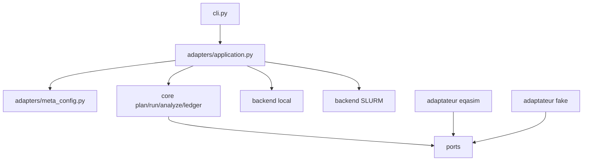

# Guide de développement

[English](../docs/development-guide.md)

## Architecture

Le paquet suit une séparation ports, cœur et adaptateurs :

```text
eqasim-sa/
├── pyproject.toml
├── uv.lock
├── src/eqasim_sa/
│   ├── cli.py
│   ├── ports/
│   │   ├── backend.py
│   │   └── simulator.py
│   ├── core/
│   │   ├── plan.py
│   │   ├── run.py
│   │   ├── ledger.py
│   │   ├── analyze.py
│   │   └── indicators/
│   ├── adapters/
│   │   ├── application.py
│   │   ├── meta_config.py
│   │   ├── data_manifest.py
│   │   ├── worker.py
│   │   ├── backends/
│   │   ├── eqasim/
│   │   └── fake/
│   └── templates/
└── tests/
```

`ports/` définit les protocoles de backend et simulateur. `core/` possède les
identités, designs, ledger et analyses sans connaître la CLI. `adapters/`
charge le YAML, invoque synpp, normalise les artefacts, gère local/SLURM et câble
l'application. `cli.py` se limite au parsing et aux enveloppes JSON.



## Dépendances déclarées

| Élément | Version/contrainte |
| --- | --- |
| Python | `>=3.13,<3.14` |
| pyarrow | `23.0.1` |
| PyYAML | `6.0.3` |
| submitit | `1.5.4` |
| numpy | `2.3.5` |
| scipy | `1.17.1` |
| pytest, dépendance optionnelle de l'extra `test` | `9.0.2` |
| setuptools, exigence du système de build uniquement | `>=80` |

Les cinq premières bibliothèques du tableau sont les dépendances d'exécution.
`pytest` n'est installé qu'avec l'extra `test`; `setuptools>=80` sert à créer le
paquet via `setuptools.build_meta` et n'est pas déclaré comme dépendance runtime.
Le paquet n'installe ni synpp, ni eqasim, ni SALib. Les designs Sobol et les
calculs reposent sur SciPy/NumPy et du code interne.

## Installer et tester

Depuis `eqasim-sa/` :

```bash
uv sync --extra test --locked
uv lock --check
uv run --locked pytest
```

Tests ciblés utiles :

```bash
uv run --locked pytest tests/test_init.py
uv run --locked pytest tests/test_plan.py tests/test_check.py
uv run --locked pytest tests/test_analyze.py tests/test_distribution.py
```

Vérifier les commandes installées :

```bash
uv run --locked eqasim-sa --help
uv run --locked eqasim-sa init --help
uv run --locked eqasim-sa-fake-pipeline --help
```

Construire les distributions à partir de la source actuelle :

```bash
uv build
```

Inspectez et testez les artefacts nouvellement produits; ne supposez pas que des
répertoires `build/` ou `dist/` préexistants reflètent la source actuelle.

## Stratégie de test observée

- Tests unitaires des identités, plans, ledger, indicateurs et statistiques.
- Tests de validation hostile sur schémas Parquet, chemins, liens symboliques et écritures atomiques.
- Tests d'intégration CLI avec un exécutable espion synpp.
- Pipeline factice pour les runs et analyses de bout en bout.
- Tests de métadonnées et commandes d'une installation construite.
- Backend SLURM testé avec doubles Submitit et contrats de rechargement.
- Tests d'interruption, reprise, idempotence et concurrence.

Les tests SLURM ne démontrent pas le fonctionnement sur un cluster réel. Aucun
fichier de configuration CI n'est revendiqué ici; exécutez les commandes
localement dans l'environnement verrouillé.

## Invariants importants

- Le YAML modèle doit rester un blob Git propre et suivi.
- Le plan est recalculable et immuable sous une racine donnée.
- Le marqueur de run est publié après les archives et constitue la preuve unique.
- Les écritures durables sont atomiques et les liens symboliques sont largement refusés.
- Les overrides d'infrastructure ne modifient pas `runId`.
- Les facteurs structurés nommés restent un mapping label-vers-liste séparé à la
  frontière adaptateur/cœur : le plan expose les labels, la résolution et le
  `runId` utilisent les listes, et le schéma v3 scelle le mapping canonique.
- Une analyse ne doit pas muter ses sources; le code sauvegarde et restaure en cas d'écart.

## Ajouter un indicateur personnalisé

Publiez un entry point Python du groupe `eqasim_sa.indicators`. Son nom doit
correspondre à `indicators[].custom.function`. L'objet chargé peut être une
classe instanciable sans argument, un callable ou un objet avec
`compute(artifacts)`. Le résultat doit être exactement un `float` fini. Le nom
d'analyse sera `function(artifact)`.

Le callable reçoit un `ArtifactSet`; utilisez `artifacts.path("name")` pour
obtenir un Parquet copié en lecture seule dans l'espace temporaire d'analyse.
Ajoutez des tests de résolution, erreur, pureté des sources et distribution.

## Caveats de distribution

Setuptools découvre les paquets sous `src` et inclut `templates/*.yml` et
`templates/*.md`. Les scripts installés sont `eqasim-sa` et
`eqasim-sa-fake-pipeline`. La prise en charge Python déclarée est volontairement
étroite; ne l'élargissez pas dans la documentation sans modifier et tester le
contrat du paquet.
