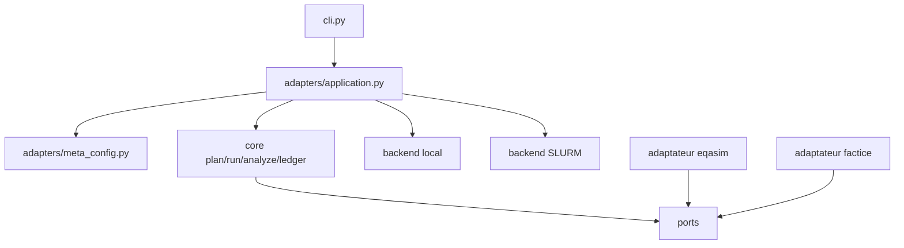

# Guide de développement

[English](../docs/development-guide.md) | **Français**

## Architecture

Le paquet suit une séparation ports, cœur et adaptateurs :

```text
eqasim-sa/
├── pyproject.toml
├── uv.lock
├── src/eqasim_sa/
│   ├── cli.py
│   ├── ports/
│   │   ├── backend.py
│   │   └── simulator.py
│   ├── core/
│   │   ├── plan.py
│   │   ├── run.py
│   │   ├── ledger.py
│   │   ├── charter.py
│   │   ├── campaign_snapshot.py
│   │   ├── analysis_publication.py
│   │   ├── analyze.py
│   │   ├── analyses.py    # déclarations des scripts d'analyse
│   │   ├── indicators/
│   │   ├── methods/       # plans et analyses par méthode
│   │   └── figures/       # catalogue et tracé des figures
│   ├── adapters/
│   │   ├── application.py
│   │   ├── meta_config.py
│   │   ├── meta_config_defaults.py
│   │   ├── project_init.py
│   │   ├── checks.py
│   │   ├── estimate.py
│   │   ├── analysis_execution.py
│   │   ├── analysis_runner.py
│   │   ├── plot.py
│   │   ├── data_manifest.py
│   │   ├── worker.py
│   │   ├── backends/
│   │   ├── eqasim/       # adaptateur, empreinte du code, fichiers de sortie, espace de travail des workers
│   │   └── fake/
│   ├── utils/            # système de fichiers, plateforme, lectures Arrow, noms
│   └── templates/
└── tests/
```

`ports/` définit les protocoles de backend et de simulateur. `core/` possède les
identités, les designs, le registre des runs (`ledger.py`) et les analyses sans
connaître la CLI. `adapters/` charge le YAML, calcule l'empreinte du code
d'eqasim, invoque synpp, copie les fichiers de sortie déclarés, exécute les
scripts d'analyse avec l'interpréteur d'eqasim, gère l'exécution locale/SLURM et
assemble l'application. `cli.py` se limite à l'analyse des arguments et aux
enveloppes JSON.

Les responsabilités liées au système de fichiers sont volontairement
regroupées dans des modules profonds : `utils/filesystem.py` possède la capture
stable et les écritures résistantes aux pannes ; `campaign_snapshot.py` possède les coupes cohérentes plan/runs/archives ;
`analysis_publication.py` possède les générations d'analyse immuables ; et
`adapters/eqasim/workspace.py` possède les emplacements de workers jetables et
leurs caches contextualisés. Les appelants ne réimplémentent ni noms
temporaires, ni descripteurs, ni retour arrière, ni inventaire de l'espace de
travail.



## Dépendances déclarées

| Élément | Version/contrainte |
| --- | --- |
| Python | `>=3.13,<3.14` |
| pyarrow | `23.0.1` |
| PyYAML | `6.0.3` |
| submitit | `1.5.4` |
| numpy | `2.3.5` |
| pandas | `2.3.3` |
| matplotlib | `3.10.8` |
| scipy | `1.17.1` |
| SALib | `1.5.2` |
| pytest, dépendance optionnelle de l'extra `test` | `9.0.2` |
| setuptools, exigence du système de construction uniquement | `>=80` |

Les huit bibliothèques entre pyarrow et SALib sont les dépendances d'exécution.
Pandas et Matplotlib sont déclarées directement et épinglées, car SALib les
importe à l'exécution ; cela empêche une dérive du résolveur transitif de modifier
l'environnement numérique.
`pytest` n'est installé qu'avec l'extra `test` ; `setuptools>=80` sert à
construire le paquet via `setuptools.build_meta` et n'est pas déclaré comme
dépendance d'exécution.
Le paquet n'installe ni synpp, ni eqasim. Les designs et analyses scientifiques
Morris et Sobol courants passent par la frontière SALib déclarée.

## Installer et tester

Depuis `eqasim-sa/` :

```bash
uv sync --extra test --locked
uv lock --check
uv run --locked pytest
```

Tests ciblés utiles :

```bash
uv run --locked pytest tests/test_init.py
uv run --locked pytest tests/test_plan.py tests/test_check.py
uv run --locked pytest tests/test_analyze.py tests/test_distribution.py
```

Vérifier les commandes installées :

```bash
uv run --locked eqasim-sa --help
uv run --locked eqasim-sa init --help
uv run --locked eqasim-sa-fake-pipeline --help
```

Construire les distributions à partir de la source actuelle :

```bash
uv build
```

Inspectez et testez les archives nouvellement produites ; ne supposez pas que des
répertoires `build/` ou `dist/` préexistants reflètent la source actuelle.

## Stratégie de test observée

- Tests unitaires des identités, plans, registre des runs, indicateurs et statistiques.
- Tests de validation hostile sur schémas Parquet du plan et des marqueurs, lecture des sorties CSV, chemins, liens symboliques et écritures atomiques.
- Tests d'intégration CLI avec un exécutable espion synpp.
- Pipeline factice pour les runs et analyses de bout en bout.
- Tests de métadonnées et commandes d'une installation construite.
- Backend SLURM testé avec doubles Submitit et contrats de rechargement.
- Tests d'interruption, reprise, idempotence et concurrence.

Les tests SLURM ne démontrent pas le fonctionnement sur un cluster réel. La
suite est testée sous Linux (Python 3.13 : 1557 réussis, 4 ignorés) ; le flux
d'intégration continue GitHub Actions `.github/workflows/tests.yml` l'exécute
sous Ubuntu, macOS et Windows, et aucun résultat Windows ou macOS n'est
revendiqué tant que l'intégration continue n'a pas tourné. Marqueurs de
plateforme : `posix_only`, `windows_only` et `linux_only` (backend slurm) sont
ignorés automatiquement ailleurs.

Note de durabilité : sous macOS, `os.fsync` vide vers le disque mais ne force pas
`F_FULLFSYNC` ; une coupure de courant peut donc encore perdre les dernières
écritures retenues dans le cache du disque. eqasim-sa n'émet pas `F_FULLFSYNC` ;
la publication atomique (complète ou absente) n'est pas affectée.

## Invariants importants

- eqasim-sa n'appelle jamais Git. L'empreinte du code d'eqasim
  (`adapters/eqasim/source_fingerprint.py`) et les octets du YAML modèle sont
  scellés dans le contexte et revérifiés avant chaque run.
- synpp reçoit la liste `run:` du YAML modèle sans modification.
- Les fichiers de sortie déclarés sont archivés à l'octet près ; seuls leur
  nom, `file` et `separator` sont scellés dans le plan.
- Le plan est recalculable et immuable sous une racine donnée.
- Le marqueur de run est publié après les archives et constitue la seule preuve de complétude.
- Les plans et marqueurs de run sont publiés sans écrasement ; un marqueur existant n'est jamais remplacé.
- Les écritures durables sont atomiques et les liens symboliques sont largement refusés.
- La coordination durable d'une campagne reste confinée à `.eqasim-sa/` ; les
  tentatives et caches contextualisés jetables restent confinés au scratch.
- Les options machine (`execution.machine_options`) ne modifient pas `runId`.
- Les facteurs structurés nommés restent une correspondance label-vers-liste
  séparée à la frontière adaptateur/cœur : le plan expose les labels, la
  résolution et le `runId` utilisent les listes, et le schéma v3 scelle la
  correspondance canonique.
- Les designs scientifiques sont en version v3 ; la vérification préalable de
  l'application la valide.
- Une analyse ne doit pas modifier ses sources : les indicateurs lisent des
  copies en lecture seule, et si une source capturée (plan, marqueur de run,
  archive) change pendant `analyze`, l'analyse échoue avec
  `selected analysis source changed: <path>` et ne publie rien ; rien n'est restauré.
- Toute lecture Parquet passe par `utils/arrow.py` (`read_parquet`, sans threads
  Arrow) et les lectures CSV passent `use_threads=False` : une lecture avec
  threads peut bloquer le processus à sa sortie. `tests/test_arrow_threads.py`
  le vérifie.

## Ajouter un type d'indicateur

Les types d'indicateur sont `tv_distance`, `share` et `value`, tous intégrés. Un utilisateur qui a besoin
d'une autre grandeur écrit un [script d'analyse](analysis-scripts.md)
(`analyses`) qui renvoie une table lue par ces types, ou la calcule dans une
étape d'analyse eqasim, déclare le fichier CSV sous `outputs` et le lit avec
`value`.

Un nouveau type intégré est une modification d'eqasim-sa lui-même.
Implémentez-le dans `core/indicators/` (calcul, définition canonique et
`KIND_VERSIONS`), analysez-le dans `adapters/meta_config.py`
(`INDICATOR_KINDS`) et documentez-le dans les deux références YAML. Changer les
octets d'une définition existante exige une nouvelle version du domaine
`eqasim-sa:indicator-definition`. Ajoutez des tests d'analyse syntaxique,
d'erreurs, de calcul sur des colonnes CSV lues comme texte et de pureté des
sources.

## Points d'attention pour la distribution

Setuptools découvre les paquets sous `src` et inclut `templates/*.yml` et
`templates/*.md`. Les scripts installés sont `eqasim-sa` et
`eqasim-sa-fake-pipeline`. La prise en charge Python déclarée est volontairement
étroite ; ne l'élargissez pas dans la documentation sans modifier et tester le
contrat du paquet.
