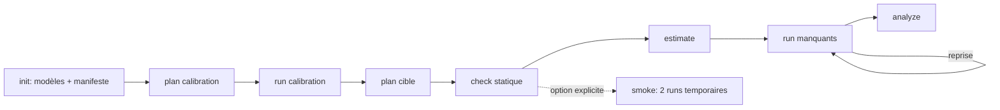

# Workflow et résultats

[English](../docs/workflow-and-results.md) | [Français](workflow-and-results.md)

## Cycle de vie



`init` prépare les modèles de configuration et hache les données; il n'entre pas
dans les étapes d'exécution du pipeline. La calibration fournit ensuite les
observations de durée, stockage durable et cache nécessaires au devis d'une
cible.

## Identités scellées

`contextHash` est défini par
`SHA-256(b"eqasim-sa:context:v1\0" + UTF8(descriptor))`, où `descriptor` est le
JSON compact à clés triées de `eqasimCommit`, `dataManifestSha256`,
`lockfileSha256` et `eqasimSaVersion`. Le résultat est une chaîne de 64
caractères hexadécimaux minuscules. Voir la
[définition complète](yaml-reference.md#model-et-context).

`runId` est constitué des 32 premiers hexadécimaux d'un SHA-256 sur la
configuration canonique et la seed. La canonicalisation retire
`working_directory`, `data_path`, binaires, mémoire Java, `output_path`,
`processes` et `random_seed` de la configuration avant hachage, puis porte la
seed séparément. Plus précisément, les binaires exclus sont `git_binary`,
`java_binary` et `maven_binary`, et la mémoire exclue est `java_memory`.
`output_prefix` n'est pas exclu et sa valeur affecte donc `runId`.

`designId` identifie une position statistique, pas une exécution. Il inclut les
indices de niveau et de réplication pour Grid, ou le rôle scellé du design pour
Morris historique, OAT discret, Morris canonique et Sobol. Deux `designId`
distincts peuvent donc partager un `runId`.

## Positions et runs uniques

`plan.parquet` contient une ligne par position. Ses colonnes fixes sont :

| Colonne | Type | Sens |
| --- | --- | --- |
| `designId` | string | identité de la position |
| `method` | string | `grid`, ancien `morris`, `discrete_oat`, `canonical_morris` ou `sobol` |
| `role` | string | `point`, étape de trajectoire ou matrice Sobol |
| `runId` | string | identité de l'exécution dédupliquée |
| `seed` | int64 | seed eqasim |
| `contextHash` | string | contexte scientifique |
| `<factor>` | type du domaine | valeur projetée de chaque facteur hors seed |

L'ancien `morris` est uniquement une provenance historique de démonstration
lisible. Les nouvelles démonstrations adjacentes utilisent `discrete_oat` et le
criblage scientifique `canonical_morris`. Les plans Morris canoniques ont
`planSchemaVersion: 2` et scellent le contrat scientifique normalisé ainsi que la
définition complète du design et de l'analyse. Les autres plans actuels et
historiques utilisent le schéma v1.

Le schéma, ses métadonnées et toutes les lignes sont recalculés lors du
chargement. Pour Sobol, l'ordre physique des lignes peut varier, mais le contenu
indexé par `designId` doit être identique.

## Scellement du plan

`plan` prend un verrou au niveau du parent de campagne et écrit atomiquement en
Zstandard. Un plan identique reste inchangé. Si `plan.parquet` existe mais
diffère, ou si la racine contient déjà un état durable sans plan, la commande
refuse de continuer. Créez une nouvelle racine au lieu d'éditer l'existante.

## Calibration et estimation

Chaque marqueur complet stocke `duration` et `scratchBytes`. Pour chaque run
observé, l'estimateur mesure séparément les octets durables en additionnant la
taille du marqueur et de tous les fichiers Parquet plats de son archive.
`estimate` calcule :

- durée moyenne observée × nombre de runs uniques pour les heures de calcul;
- taille moyenne durable × runs uniques, plus la taille du plan, pour le disque;
- maximum `scratchBytes` observé × nombre de workers pour le scratch.

Ce sont des extrapolations moyennes, pas des garanties de quota ou de durée.
Les observations de la cible déjà complète sont également prises en compte.

## Arborescences de stockage

```text
campaigns/grid/
├── plan.parquet
├── runs/
│   └── <runId>.parquet
├── archives/
│   └── <runId>/
│       ├── persons.parquet
│       ├── households.parquet
│       ├── activities.parquet
│       ├── trips.parquet
│       ├── vehicle_types.parquet
│       ├── vehicles.parquet
│       ├── age.parquet
│       ├── age_purpose.parquet
│       ├── distance.parquet
│       ├── license.parquet
│       ├── nbr_vehicle.parquet
│       └── travel.parquet
├── logs/
│   └── <runId>.log
├── indicators.parquet
├── replication-dispersion.parquet
└── analysis-generation.json
```

Les logs n'existent que pour les échecs publiés. L'arbre montre les six artefacts
de `synthesis.output` et les six artefacts supplémentaires lorsque
`analysis.synthesis.population` est demandée. Seules les étapes requises par les
indicateurs sont exécutées, avec `synthesis.output` toujours présente.

```text
scratch/eqasim-sa/<campaign>/workers/<slot>/
├── lease.lock
├── state.json
├── cache/
└── attempt-<uuid>/
```

Le scratch contient les caches synpp et tentatives temporaires. Il est jetable.

## Marqueur de complétude

`runs/<runId>.parquet` est écrit en dernier. Il contient une seule ligne,
compressée Zstandard :

| Colonne | Sens |
| --- | --- |
| `runId`, `campaign`, `seed`, `contextHash` | identité attendue |
| `status` | toujours `completed` |
| `attempts` | toujours `1` dans le format actuel |
| `node` | nom du nœud d'exécution |
| `duration` | secondes monotoniques, float fini non négatif |
| `scratchBytes` | taille du cache worker après le run |
| facteurs | valeurs scientifiques du run |

Une archive sans marqueur est incomplète. Un marqueur au mauvais schéma, avec
une identité différente, un nom étranger ou une compression différente est une
erreur. La validation exige un fichier ordinaire sans lien symbolique, exactement
une ligne, le schéma attendu, aucune valeur nulle, les valeurs et types exacts de
`runId`, `campaign`, `seed`, `status: completed`, `attempts: 1`, `contextHash` et
des facteurs, un `duration` de type float fini et non négatif, un `scratchBytes`
entier non négatif, et la compression Zstandard de toutes les colonnes. Le
répertoire `runs/` ne peut contenir aucun nom étranger. Le champ `node` est une
chaîne non nulle validée par le schéma. L'archive est validée séparément par
`estimate` et `analyze`; le marqueur reste la preuve de complétude.

## Sorties d'analyse

### `indicators.parquet`

| Colonne | Description |
| --- | --- |
| `runId` | run source |
| `indicator` | nom résolu de l'indicateur |
| `value` | float fini calculé |

### `replication-dispersion.parquet`

Produit quand la seed est une réplication. Les colonnes de facteurs sont suivies
de `indicator`, `n`, `mean`, `std`, `cv`, `ci95_low`, `ci95_high`. L'intervalle
utilise `mean ± 1.96 × std/√n`; avec une seule observation, les statistiques de
dispersion `std`, `cv`, `ci95_low` et `ci95_high` sont nulles; `n` vaut 1 et
`mean` conserve la valeur observée.

### `morris-ranking.parquet` (compatibilité historique)

Colonnes : `indicator`, `factor`, `rank`, `trajectories`, `replications`, `n`,
`mu`, `mu_star`, `sigma`, `seed_std`. Le rang est ordonné par `mu_star`
décroissant puis nom du facteur. Cette sortie appartient uniquement à la
provenance historique lisible `method: morris` et n'est pas recommandée.

### `discrete-oat-effects.parquet`

Produite pour `method: discrete_oat`. Elle reprend les colonnes adjacentes
historiques : `indicator`, `factor`, rang entier `rank`, `trajectories`,
`replications`, `n`, `mu`, `mu_star`, `sigma` nullable et `seed_std` nullable.
Les effets utilisent des niveaux numériques adjacents et normalisent chaque pas
local par l'étendue totale déclarée. Cette sortie de démonstration n'est pas
Morris canonique, n'estime pas des parts de variance et ne justifie pas FF.

### `canonical-morris-ranking.parquet`

Produite au checkpoint final de `method: canonical_morris`. Colonnes :
`indicator`, `factor`, rang float `rank`, `rank_ci_low`, `rank_ci_high`,
`top_k_probability`, `trajectories`, `replications`, `elementary_effects`,
`delta`, `mu`, `mu_star`, `mu_star_ci_low`, `mu_star_ci_high`, `sigma` nullable,
`seed_std` nullable, `bootstrap_resamples`, `confidence_level`.

Les effets sont d'abord moyennés sur les `R` réplications de chaque trajectoire,
puis les estimations sont calculées sur les `T` moyennes de trajectoire. Ainsi,
`elementary_effects` enregistre le compte calculé `T*R`, mais les unités
effectives du bootstrap sont les `T` trajectoires, pas `T*R` effets. `seed_std`
est la racine carrée de la moyenne des variances intra-trajectoire sur les seeds
et vaut `null` pour `R=1`.

Les rangs sont des floats car les égalités exactes de `mu_star` reçoivent leur
rang moyen. Chaque réplication bootstrap applique la même règle. Si un groupe
ex aequo traverse la coupure top-k, les places restantes sont réparties
fractionnellement dans le groupe ; `top_k_probability` moyenne ces allocations.
Les bornes de l'intervalle de `mu_star` utilisent les quantiles linéaires NumPy
par défaut. Les bornes de rang utilisent les quantiles empiriques `lower` et
`higher` afin de respecter le support observé des rangs.

### `canonical-morris-convergence.parquet`

Contient les mêmes colonnes et calculs que le classement, avec
`checkpoint_trajectories` à la place de `trajectories`, pour chaque checkpoint
déclaré. Ces lignes sont des diagnostics. Leur présence ou leur stabilité
apparente ne certifie pas automatiquement les critères d'arrêt ou les contrôles
de robustesse de la charte ; cette gouvernance distincte reste ultérieure.

### `canonical-morris-rank-reversals.parquet`

Colonnes : `indicator`, `checkpoint_trajectories`, `factor_a`, `factor_b`,
`point_order`, `reversal_probability` nullable, `tie_probability`,
`bootstrap_resamples`. Les paires suivent le `mu_star` ponctuel décroissant.
`point_order` vaut 1 pour cet ordre strict et 0 en cas d'égalité ponctuelle. Dans
ce dernier cas, `reversal_probability` vaut `null`, car aucune direction n'est
privilégiée ; `tie_probability` donne tout de même la fréquence d'égalité au
bootstrap. Sinon, la probabilité d'inversion est la fraction des réplications du
bootstrap de trajectoires où `factor_a` a un `mu_star` inférieur à `factor_b`.

Le bootstrap canonique de trajectoires fournit une preuve d'incertitude de
design fini conditionnelle au contrat de criblage scientifique déclaré et
scellé. Ces tables ne fournissent pas seules une preuve décisionnelle calibrée
ni des conclusions FP/FF.

### `sobol-indices.parquet`

Colonnes : `indicator`, `factor`, `rank`, `base_sample_size`,
`bootstrap_resamples`, `bootstrap_attempts`, `first_order`,
`first_order_ci_low`, `first_order_ci_high`, `total_order`,
`total_order_ci_low`, `total_order_ci_high`. Le rang suit l'ordre total
décroissant. Ce fichier appartient au Sobol historique; son bootstrap de lignes
reste non inférentiel et le manifeste porte
`inferenceStatus: legacy_noninferential`.

### Sorties Sobol multi-scramble

`multiscramble_sobol` publie transactionnellement quatre fichiers :
`multiscramble-sobol-indices.parquet` pour le checkpoint final et les rangs,
`multiscramble-sobol-by-scramble.parquet` pour chaque estimation indépendante,
`multiscramble-sobol-convergence.parquet` pour les moyennes, SD, SE et intervalles
de Student entre scrambles, et `multiscramble-sobol-diagnostics.parquet` pour les
contrastes, valeurs hors plage, gaps négatifs et duplications de runId. Les
tables agrégées portent le booléen non nul `is_primary_indicator`; les indices
bruts ne sont pas tronqués. FP classe la moyenne de premier ordre par ordre
décroissant et laisse `within_practical_tolerance` nul. FF classe la borne
supérieure totale par ordre croissant pour tous les indicateurs, mais seule
l'indicateur primaire scellé reçoit une classification : la seed vaut toujours
`false`, les autres facteurs comparent leur borne supérieure de Student à la
tolérance. Les indicateurs secondaires restent diagnostiques et leur
classification FF est nulle. Le manifeste v4 contient tous les chemins et
hachages. Une ligne de convergence ne satisfait pas automatiquement un critère
d'arrêt.

### `analysis-generation.json`

Pour Grid, Morris historique, OAT discret et Sobol, le manifeste est en version 2
avec SHA-256 des sorties, méthode de sensibilité, `expected`, `completed`,
`missing`, `failed` et `completionRate`. Morris canonique publie la version 3,
qui ajoute noms et SHA-256 des tables de classement, convergence et inversions de
rang. La publication de toutes les sorties canoniques et du manifeste est
transactionnelle.

Pour les méthodes scientifiques, l'adaptateur applicatif reconstruit le design
depuis la méta-configuration courante et valide chaque identité de run avant
l'analyse core. Le core seul ne reçoit pas la configuration modèle de base et ne
peut donc pas recalculer ces identités; ce contrôle complet appartient au
préflight de l'adaptateur, sans heuristique core affaiblie.

## Idempotence et récupération

`run` valide le plan, déduit les runs uniques, valide tous les marqueurs présents
et n'envoie que les runs manquants. Une relance après interruption reprend donc
sans recalculer les runs complets. Une relance totalement complète renvoie un
succès avec `total: 0`.

Les écritures Parquet utilisent un fichier temporaire, `fsync` et remplacement
atomique. `analyze` sauvegarde les sources et sorties avant publication et les
restaure si un indicateur les mute ou si l'analyse échoue.

Ne réparez jamais un état en créant un marqueur ou en modifiant un plan. Corrigez
la cause, supprimez seulement le scratch jetable si aucun processus n'est actif,
puis relancez la même commande.

## Workers, caches et leases

Les runs sont distribués en lots entre au plus `workers` slots. Chaque slot
traite son lot en série et réutilise son cache. Un lease privé empêche deux
processus d'utiliser le même cache. `state.json` vaut `active` ou `clean`; un
état absent, invalide ou non propre entraîne la purge du cache avant réutilisation.

Un lease par `runId` complète cette protection côté SLURM. Les caches ne sont
jamais partagés entre slots.

## Local et SLURM

Le backend local lance les lots en parallèle dans le processus de commande et
interrompt les groupes de sous-processus sur `Ctrl-C`. Le backend SLURM utilise
Submitit, un job array et `slurm_array_parallelism=workers`; chaque job recharge
la méta-configuration et revérifie son SHA-256 et le `contextHash`.

Le code et les tests couvrent la construction et le comportement simulé du
backend SLURM. Ils ne constituent pas une validation sur un cluster SLURM réel.

Voir le [glossaire](glossary.md) pour les termes d'identité et de stockage.
