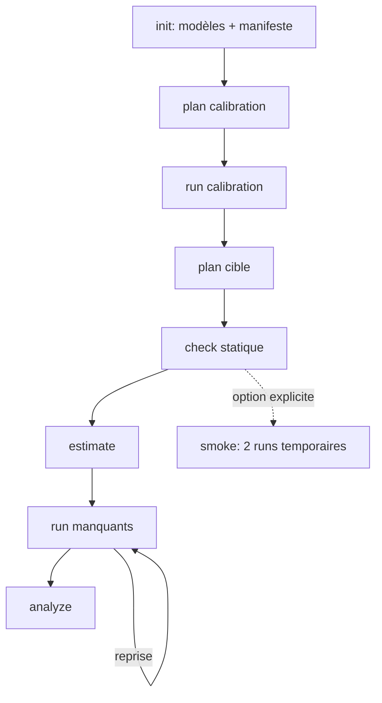

# Workflow et résultats

[English](../docs/workflow-and-results.md) | [Français](workflow-and-results.md)

## Cycle de vie



`init` prépare les modèles de configuration et hache les données; il n'entre pas
dans les étapes d'exécution du pipeline. La calibration fournit ensuite les
observations de durée, stockage durable et cache nécessaires au devis d'une
cible.
`analyze` peut être relancé à tout moment après les runs, par exemple avec de
nouveaux [scripts d'analyse](#scripts-danalyse) ; il ne modifie jamais le plan
ni les archives des runs.

## Identités scellées

`contextHash` est défini par
`SHA-256(b"eqasim-sa:context:v3\0" + ASCII(descriptor))`, où `descriptor` est le
JSON compact à clés triées de `eqasimSourceSha256` (l'empreinte du code
d'eqasim, calculée sans Git), `dataManifestSha256`, `lockfileSha256` et
`eqasimSaVersion`. Le résultat est une chaîne de 64
caractères hexadécimaux minuscules. Voir la
[définition complète](yaml-reference.md#lempreinte-du-code-deqasim).

Le plan scelle aussi les sorties déclarées (`outputsDeclaration`) : pour chaque
sortie, son nom, son `file` et son `separator`. Ils déterminent ce que chaque
run archive. Les colonnes lues par les indicateurs (`category`, `simulated`,
`references`) et les indicateurs eux-mêmes ne sont pas scellés : ils sont lus
dans la méta-configuration courante à chaque `analyze`.

Le plan scelle aussi la configuration eqasim (`modelDocument`) : le JSON
compact, à clés triées, de la configuration de base sans les clés exclues du
`runId` (listées ci-dessous) ni `random_seed`. Modifier une clé propre à la
machine (`data_path`, `processes`...) ne change donc ni le plan ni la reprise
de `run`. `analyze` reconstruit les runs à partir de ce que le plan a scellé
(`modelDocument` et contexte) et vérifie les facteurs, les étapes de `run:`,
`output_formats` et `output_prefix` de la méta-configuration par rapport à
`modelDocument`, pas par rapport au dossier eqasim courant : modifier le code,
la configuration ou le `uv.lock` d'eqasim après les runs ne bloque pas
`analyze`, alors que `run` refuse toujours la reprise. Un plan sans
`modelDocument` est refusé.

`runId` est constitué des 32 premiers hexadécimaux d'un SHA-256 sur la
configuration canonique et la seed. La canonicalisation retire
`working_directory`, `data_path`, binaires, mémoire Java, `output_path`,
`processes` et `random_seed` de la configuration avant hachage, puis porte la
seed séparément. Plus précisément, les binaires exclus sont `git_binary`,
`java_binary` et `maven_binary`, et la mémoire exclue est `java_memory`.
`output_prefix` n'est pas exclu et sa valeur affecte donc `runId`.

`designId` identifie une position statistique, pas une exécution. Il inclut les
indices de niveau et de réplication pour Grid, ou le rôle scellé du design pour
OAT discret, Morris canonique et Sobol. Deux `designId`
distincts peuvent donc partager un `runId`.

## Positions et runs uniques

`plan.parquet` contient une ligne par position. Ses colonnes fixes sont :

| Colonne | Type | Sens |
| --- | --- | --- |
| `designId` | string | identité de la position |
| `method` | string | `grid`, `discrete_oat`, `canonical_morris` ou `sobol` |
| `role` | string | `point`, étape de trajectoire ou matrice Sobol |
| `runId` | string | identité de l'exécution dédupliquée |
| `seed` | int64 | seed eqasim |
| `contextHash` | string | contexte scientifique |
| `<factor>` | type du domaine | valeur projetée de chaque facteur hors seed |

Les démonstrations adjacentes utilisent `discrete_oat` et le
criblage scientifique `canonical_morris`. Les plans Morris canoniques non structures ont
`planSchemaVersion: 2` et scellent le contrat scientifique normalisé ainsi que la
définition complète du design et de l'analyse. Les autres plans non structures utilisent le schéma v1. Tout design pris en charge
avec un facteur liste structuree nomme utilise le schema v3 et scelle les
metadonnees structurees canoniques v1 ; la colonne garde le label tandis que le
`runId` hache la liste ordonnee resolue.

Le schéma, ses métadonnées et toutes les lignes sont recalculés lors du
chargement. Pour Sobol, l'ordre physique des lignes peut varier, mais le contenu
indexé par `designId` doit être identique.

## Scellement du plan

`plan` prend un verrou au niveau du parent de campagne et écrit atomiquement en
Zstandard. Un plan identique reste inchangé. Si `plan.parquet` existe mais
diffère, ou si la racine contient déjà un état durable sans plan, la commande
refuse de continuer. Créez une nouvelle racine au lieu d'éditer l'existante.

## Calibration et estimation

Chaque marqueur complet stocke `duration` et `scratchBytes`. Pour chaque run
observé, l'estimateur mesure séparément les octets durables en additionnant la
taille du marqueur et de tous les fichiers de son archive.
`estimate` calcule :

- durée moyenne observée × nombre de runs uniques pour les heures de calcul;
- taille moyenne durable × runs uniques, plus la taille du plan, pour le disque;
- maximum `scratchBytes` observé × nombre de workers pour le scratch.

Ce sont des extrapolations moyennes, pas des garanties de quota ou de durée.
Les observations de la cible déjà complète sont également prises en compte.

## Arborescences de stockage

```text
campaigns/mon-analyse-sa-grid/
├── plan.parquet
├── runs/
│   └── <runId>.parquet
├── archives/
│   └── <runId>/
│       ├── persons.csv
│       ├── households.csv
│       ├── trips.csv
│       ├── activities.csv
│       ├── activities_spatial.gpkg
│       ├── age.csv
│       ├── distance.csv
│       └── nbr_vehicle.csv
├── logs/
│   └── <runId>.log
├── .eqasim-sa/
│   ├── locks/
│   │   ├── runs/<runId>.lock
│   │   ├── analysis.lock
│   │   └── slurm.lock
│   ├── transactions/
│   └── slurm/
│       ├── submission-intent.json  # tant que l'issue de soumission est inconnue
│       ├── active-jobs.json        # tant que les jobs sont possédés
│       └── submitit/
├── analyses-cache/  # résultats recalculables des scripts d'analyse
│   ├── <analyse>/
│   │   ├── <empreinte>.csv
│   │   └── <empreinte>.sha256
│   └── logs/<analyse>-<runId>.log
├── analysis/
│   ├── staging/
│   └── generations/
│       └── <generationId>/
│           ├── captured-run-set.json
│           ├── indicators.parquet
│           ├── replication-dispersion.parquet
│           ├── output-summary.parquet
│           ├── convergence-evidence.parquet  # méthodes scientifiques uniquement
│           └── governed-report.json
└── analysis-generation.json
```

Les logs n'existent que pour les échecs publiés. L'archive contient un fichier
par sortie déclarée dans la méta-configuration, ici les huit sorties des
modèles. Chaque fichier est une copie à l'octet près de ce qu'eqasim a écrit,
nommée `<nom de la sortie><extension>` ; les fichiers non déclarés ne sont pas
conservés. eqasim exécute la liste `run:` de votre configuration eqasim sans la
modifier : cette liste doit donc contenir les étapes qui écrivent les fichiers
déclarés.
Les sorties d'analyse finales résident dans un unique répertoire immuable
`analysis/generations/<generationId>/`. `analysis/staging/` ne contient que le
travail transactionnel et reste vide après la fin normale d'une commande.
`analyses-cache/` contient les résultats des [scripts d'analyse](#scripts-danalyse)
et leurs journaux d'erreur ; il peut être supprimé quand aucune commande ne
tourne.
`.eqasim-sa/` regroupe la coordination technique durable propre à la campagne :
leases privées aux modules, transactions run sur le même filesystem et état
Submitit. Ce répertoire n'est pas du scratch, n'est jamais créé dans le parent
de la campagne et disparaît avec elle. `init` refuse une campagne contenant
`.submitit`, `.eqasim-sa-tmp` ou `.eqasim-sa-run-locks`.

```text
scratch/eqasim-sa/<campaign>/workers/<slot>/
├── lease.lock
├── state-<contextHash>.json
├── cache/<contextHash>/
└── attempt-<uuid>/
```

Le scratch contient les caches synpp et tentatives temporaires. Il est jetable.

## Marqueur de complétude

`runs/<runId>.parquet` est écrit en dernier. Il contient une seule ligne,
compressée Zstandard :

| Colonne | Sens |
| --- | --- |
| `runId`, `campaign`, `seed`, `contextHash` | identité attendue |
| `status` | toujours `completed` |
| `attempts` | toujours `1` dans le format actuel |
| `node` | nom du nœud d'exécution |
| `duration` | secondes monotoniques, float fini non négatif |
| `scratchBytes` | taille du cache worker après le run |
| facteurs | valeurs scientifiques du run |

Le marqueur porte aussi deux métadonnées. `artifactManifest` liste chaque
fichier archivé avec le `name` de sa sortie, son `sourcePath` (le chemin
d'origine sous le dossier de sortie d'eqasim, par exemple
`analysis_population/nantes_age.csv`), sa taille et son SHA-256.
`executionEvidence` (version de schéma 3) enregistre la façon dont le run a été
exécuté, dont l'empreinte du code d'eqasim (`modelSourceSha256`).

Une archive sans marqueur est incomplète. Un marqueur au mauvais schéma, avec
une identité différente, un nom étranger ou une compression différente est une
erreur. La validation exige un fichier ordinaire sans lien symbolique, exactement
une ligne, le schéma attendu, aucune valeur nulle, les valeurs et types exacts de
`runId`, `campaign`, `seed`, `status: completed`, `attempts: 1`, `contextHash` et
des facteurs, un `duration` de type float fini et non négatif, un `scratchBytes`
entier non négatif, et la compression Zstandard de toutes les colonnes. Le
répertoire `runs/` ne peut contenir aucun nom étranger. Le champ `node` est une
chaîne non nulle validée par le schéma. L'archive est validée séparément par
`estimate` et `analyze`; le marqueur reste la preuve de complétude.

## Sorties d'analyse

### `indicators.parquet`

| Colonne | Description |
| --- | --- |
| `runId` | run source |
| `indicator` | nom résolu de l'indicateur |
| `value` | float fini calculé |

### `replication-dispersion.parquet`

Produit quand la seed est une réplication. Les colonnes de facteurs sont suivies
de `indicator`, `n`, `mean`, `std`, `cv`, `ci95_low`, `ci95_high`. L'intervalle
utilise `mean ± 1.96 × std/√n`; avec une seule observation, les statistiques de
dispersion `std`, `cv`, `ci95_low` et `ci95_high` sont nulles; `n` vaut 1 et
`mean` conserve la valeur observée.

### `output-summary.parquet`

Produit pour toute analyse. Pour chaque indicateur, il fournit `n`, `mean`,
l'écart-type non biaisé `standardDeviation`, `minimum`, les quantiles linéaires
`q05`, `median`, `q95` et `maximum`. Les valeurs sont rejointes à chaque ligne de
`plan.parquet` : les positions de design structurellement dupliquées conservent
donc leur poids au lieu d'être réduites aux runId uniques.

### `discrete-oat-effects.parquet`

Produite pour `method: discrete_oat`. Colonnes : `indicator`, `factor`, rang entier `rank`, `trajectories`,
`replications`, `n`, `mu`, `mu_star`, `sigma` nullable et `seed_std` nullable.
Les effets utilisent des niveaux numériques adjacents et normalisent chaque pas
local par l'étendue totale déclarée. Cette sortie de démonstration n'est pas
Morris canonique, n'estime pas des parts de variance et ne justifie pas FF.

### `canonical-morris-ranking.parquet`

Produite au checkpoint final de `method: canonical_morris`. Colonnes :
`indicator`, `factor`, rang float `rank`, `rank_ci_low`, `rank_ci_high`,
`top_k_probability`, `trajectories`, `replications`, `elementary_effects`,
`delta`, `mu`, `mu_star`, `mu_star_ci_low`, `mu_star_ci_high`, `sigma` nullable,
`seed_std` nullable, `bootstrap_resamples`, `confidence_level`.

Les effets sont d'abord moyennés sur les `R` réplications de chaque trajectoire,
puis les estimations sont calculées sur les `T` moyennes de trajectoire. Ainsi,
`elementary_effects` enregistre le compte calculé `T*R`, mais les unités
effectives du bootstrap sont les `T` trajectoires, pas `T*R` effets. `seed_std`
est la racine carrée de la moyenne des variances intra-trajectoire sur les seeds
et vaut `null` pour `R=1`; les chartes scientifiques courantes exigent `R>=2`.

Les rangs sont des floats car les égalités exactes de `mu_star` reçoivent leur
rang moyen. Chaque réplication bootstrap applique la même règle. Si un groupe
ex aequo traverse la coupure top-k, les places restantes sont réparties
fractionnellement dans le groupe ; `top_k_probability` moyenne ces allocations.
Les bornes de l'intervalle de `mu_star` utilisent les quantiles linéaires NumPy
par défaut. Les bornes de rang utilisent les quantiles empiriques `lower` et
`higher` afin de respecter le support observé des rangs.

### `canonical-morris-convergence.parquet`

Contient les mêmes colonnes et calculs que le classement, avec
`checkpoint_trajectories` à la place de `trajectories`, pour chaque checkpoint
déclaré. Ces lignes alimentent la preuve de convergence gouvernée distincte.

### `canonical-morris-rank-reversals.parquet`

Colonnes : `indicator`, `checkpoint_trajectories`, `factor_a`, `factor_b`,
`point_order`, `reversal_probability` nullable, `tie_probability`,
`bootstrap_resamples`. Les paires suivent le `mu_star` ponctuel décroissant.
`point_order` vaut 1 pour cet ordre strict et 0 en cas d'égalité ponctuelle. Dans
ce dernier cas, `reversal_probability` vaut `null`, car aucune direction n'est
privilégiée ; `tie_probability` donne tout de même la fréquence d'égalité au
bootstrap. Sinon, la probabilité d'inversion est la fraction des réplications du
bootstrap de trajectoires où `factor_a` a un `mu_star` inférieur à `factor_b`.

Le bootstrap canonique de trajectoires fournit une preuve d'incertitude de
design fini conditionnelle au contrat de criblage scientifique déclaré et
scellé. Ces tables ne fournissent pas seules une preuve décisionnelle calibrée
ni des conclusions FP/FF.

### `noise-floor.parquet` et `replication-allocation.json`

Toute analyse canonique publie les colonnes strictes `indicator`, `trajectory`,
`rank`, `role`, `replications`, `mean`, `intrinsic_variance`, `intrinsic_sd`,
`mcse` et `is_primary_indicator`. La variance non biaisée ponctuelle est en unités
de l'indicateur au carré; SD, moyenne et MCSE sont dans les unités de l'indicateur.
Les réplications restent descriptives et ne sont jamais bootstrapées comme des
trajectoires.

Seul un pilote publie `replication-allocation.json` : quantile déclaré et valeur,
MCSE cible, nombres brut/sélectionné/courant, positions structurelles de
production, runs disponibles hors réserve, `withinTarget` et politique de seed.
Le statut vaut `recommended`, `capped` ou `infeasible`; aucun n'autorise à muter
le pilote. Créez une nouvelle racine de production, passez à `phase: production`,
reprenez le nombre sélectionné et citez la sortie pilote comme provenance. La
production publie le bruit, sans recommandation.

### `sobol-indices.parquet`

Colonnes : `indicator`, `factor`, `rank`, `base_sample_size`,
`bootstrap_resamples`, `bootstrap_attempts`, `first_order`,
`first_order_ci_low`, `first_order_ci_high`, `total_order`,
`total_order_ci_low`, `total_order_ci_high`. Le rang suit l'ordre total
décroissant. Ce fichier appartient au Sobol de démonstration; son bootstrap de lignes
reste non inférentiel et le manifeste porte
`inferenceStatus: demonstration_noninferential`.

### Sorties Sobol multi-scramble

`multiscramble_sobol` publie transactionnellement quatre fichiers :
`multiscramble-sobol-indices.parquet` pour le checkpoint final et les rangs,
`multiscramble-sobol-by-scramble.parquet` pour chaque estimation indépendante,
`multiscramble-sobol-convergence.parquet` pour les moyennes, SD, SE et intervalles
de Student entre scrambles, et `multiscramble-sobol-diagnostics.parquet` pour les
contrastes, valeurs hors plage, gaps négatifs et duplications de runId. Les
tables facteur portent le booléen non nul `is_actionable` et les tables agrégées
portent aussi `is_primary_indicator`; les indices
bruts ne sont pas tronqués. FP classe la moyenne de premier ordre par ordre
décroissant et laisse `within_practical_tolerance` nul. FF classe la borne
supérieure totale par ordre croissant pour tous les indicateurs, mais seule
l'indicateur primaire scellé reçoit une classification : la seed est non
actionnable avec rang et tolérance nuls; les autres facteurs comparent leur borne
supérieure de Student à la tolérance. Les indicateurs secondaires restent
diagnostiques et leur classification FF est nulle. Une ligne de convergence ne
satisfait pas automatiquement un critère d'arrêt; celui-ci est évalué dans
`convergence-evidence.parquet`.

Toutes les valeurs sources des indicateurs doivent être finies. L'estimation
Sobol centre et met à l'échelle les tableaux A/B/hybrides complets avant l'appel
à SALib, puis publie `output_variance` dans les unités carrées d'origine. Une
variance de base constante, sa perte à la précision `float64`, un indice non fini
ou une variance hors de la plage représentable en `float64` annule toute la
transaction. L'analyseur ne tronque aucune valeur, n'écarte aucun scramble et ne
publie pas les autres tables.

### `convergence-evidence.parquet` et `governed-report.json`

Les méthodes scientifiques publient `metric`, `checkpoint` et `value` nullables,
`threshold`, `passed`, `consecutivePasses`, `criterionMet` et
`evaluationStatus`. Pour Morris canonique, `rank_stability` est le changement de
rang absolu maximal de l'indicateur primaire sur les facteurs actionnables,
divisé par `max(1,D-1)`, après le premier checkpoint. Pour Sobol multi-scramble,
`ci_width` est la largeur maximale de premier ordre en FP ou d'ordre total en FF.
Le compte final de passages consécutifs doit atteindre la valeur scellée. Une
métrique non prise en charge, incomplète ou non finie échoue de façon fermée.

`governed-report.json` enregistre la décision scellée, les hachages des preuves,
les exclusions, les facteurs non actionnables, les preuves compatibles avec
l'objectif, la convergence, les contrôles de robustesse en attente, le statut
d'inférence, les codes de raison et `claimAuthorized`. Une démonstration, y compris Sobol de démonstration, vaut
`demonstration_noninferential`, et un
pilote canonique `pilot_only`. Une production scientifique vaut `unstable` tant
que l'arrêt échoue, puis `conditional` tant que la robustesse reste en attente.
Le contrat actuel ne peut donc produire ni `robust` ni une autorisation de
revendication. Les preuves FF sont limitées à l'indicateur primaire scellé et
utilisent les bornes supérieures d'ordre total.

### `analysis-generation.json`

Le manifeste version 8 est le pointeur remplacé atomiquement vers la génération
immuable courante. Son `layout` reste `immutable-generation-v1` ;
`generationPath` désigne `analysis/generations/<generationId>` et chaque sortie
porte son chemin relatif, sa taille et son SHA-256. Les artefacts propres aux
méthodes restent dans cette génération avec leurs hachages. La
publication reste transactionnelle.

Pour les méthodes scientifiques, l'adaptateur applicatif reconstruit le design
depuis la méta-configuration et la configuration eqasim scellée dans le plan
(`modelDocument`), et valide chaque identité de run avant l'analyse core. Le core seul ne reçoit pas la configuration modèle de base et ne
peut donc pas recalculer ces identités; ce contrôle complet appartient au
préflight de l'adaptateur, sans heuristique core affaiblie.

`captured-run-set.json` (version de schéma 2) liste les runs lus par
l'analyse ; chaque run porte un dictionnaire `analyses`, vide quand aucun
indicateur ne lit de sortie d'analyse. Le manifeste reprend ces
enregistrements sous `provenance.analyses`, par analyse puis par `runId`.

## Scripts d'analyse

Un script d'analyse, déclaré sous [`analyses`](yaml-reference.md#analyses),
calcule une sortie d'analyse à partir des fichiers archivés de chaque run ; le
guide [Écrire un script d'analyse](analysis-scripts.md) explique comment en
écrire un. `analyze` n'exécute que les analyses lues par au moins un
indicateur, après avoir capturé et vérifié les archives des runs, sous le
lease `analysis.lock`. Chaque script s'exécute dans un processus séparé avec
l'interpréteur d'eqasim, sur des copies des entrées archivées ; les archives et
le plan ne sont jamais modifiés. Au plus `execution.workers` scripts
s'exécutent à la fois. Toute erreur d'un script fait échouer toute l'analyse,
même avec `completeness_threshold` inférieur à 1, avec
`analysis '<nom>' failed for run <runId>: <dernière ligne de l'erreur>` ; la
sortie d'erreur complète se trouve dans `analyses-cache/logs/<nom>-<runId>.log`.

Chaque résultat est identifié par son empreinte, un SHA-256 de domaine
`eqasim-sa:analysis-result:v1` du nom de l'analyse, du SHA-256 du script (fins
de ligne normalisées), du SHA-256 de chaque entrée, des paramètres du run
(`runId`, `seed`, `factors`) et de l'empreinte de l'environnement. L'empreinte
de l'environnement est un SHA-256 des versions de Python, pandas, numpy et
pyarrow rapportées par l'interpréteur et du SHA-256 de `uv.lock` dans le
dossier eqasim, mesurée une fois par `analyze`. Les résultats sont gardés dans
`analyses-cache/<analyse>/<empreinte>.csv`, publié atomiquement après
`<empreinte>.sha256`. Un résultat dont l'empreinte est en cache est réutilisé ;
une entrée altérée est supprimée, recalculée et signalée dans le champ
`warnings` du résultat d'`analyze`. Supprimer le cache ne fait rien perdre.

Pour chaque sortie d'analyse et chaque run, l'analyse publiée enregistre
l'empreinte du résultat, le SHA-256 du script, l'empreinte de l'environnement,
le SHA-256 de chaque entrée, ainsi que le SHA-256 et la taille du résultat. Les
indicateurs qui lisent une sortie d'analyse la décrivent par `{name, analysis,
inputs, separator}` dans leur définition (domaine
`eqasim-sa:indicator-definition:v4`). Le `primary_indicator` d'une charte
scientifique ne peut pas lire une sortie d'analyse.

Déroulement type : planifier et exécuter la campagne sur un supercalculateur,
rapatrier le dossier de campagne, ajouter à la méta-configuration les scripts
et les indicateurs qui les lisent, puis lancer `analyze`. Comme `analyze`
vérifie la méta-configuration par rapport à ce que le plan a scellé, eqasim
peut changer sur la machine d'analyse ; `check` n'exécute pas les scripts (ses
runs de smoke ignorent les indicateurs qui lisent une sortie d'analyse) : un
script défaillant n'apparaît donc qu'à `analyze`.

## Idempotence et récupération

`run` valide le plan, déduit les runs uniques, valide tous les marqueurs présents
et n'envoie que les runs manquants. Une relance après interruption reprend donc
sans recalculer les runs complets. Une relance totalement complète renvoie un
succès avec `total: 0`.

Les écritures durables utilisent un staging sur le même filesystem, `fsync` et
soit une création exclusive, soit un remplacement restaurable. `analyze`
capture une coupe stable de la campagne, sérialise dans sa transaction de
génération privée et ne déplace le pointeur qu'après avoir revérifié toutes les
sources sélectionnées.

Ne réparez jamais un état en créant un marqueur ou en modifiant un plan. Corrigez
la cause, supprimez seulement le scratch jetable si aucun processus n'est actif,
puis relancez la même commande.

## Workers, caches et leases

Les runs sont distribués en lots entre au plus `workers` slots. Chaque slot
traite son lot en série et réutilise son cache. Un lease privé empêche deux
processus d'utiliser le même cache. `state-<contextHash>.json` vaut `active` ou
`clean`; un état absent, invalide ou non propre entraîne la purge du cache avant
réutilisation.

Un lease par `runId` complète cette protection entre invocations. La publication
d'analyse et le journal SLURM possèdent chacun leur lease privée. Aucun lock
d'orchestration global n'existe. Les caches ne sont jamais partagés entre slots
ou contextes.

## Local et SLURM

Le backend local lance les lots en parallèle dans le processus de commande et
interrompt les groupes de sous-processus sur `Ctrl-C`. Le backend SLURM utilise
Submitit, un job array et `slurm_array_parallelism=workers`; chaque job recharge
la méta-configuration et revérifie son SHA-256 et le `contextHash`.
Les fichiers Submitit, l'intention durable de soumission et le journal des jobs
actifs résident sous `<campaign>/.eqasim-sa/slurm/`; aucun état ordonnanceur
n'est dispersé parmi les sorties scientifiques. L'intention est écrite avant de
contacter l'ordonnanceur : si sa réponse est perdue, elle bloque toute relance
automatique jusqu'à vérification humaine, ce qui évite les tableaux dupliqués.
Le journal récupère les hardlinks temporaires interrompus.

Le code et les tests couvrent la construction et le comportement simulé du
backend SLURM. Ils ne constituent pas une validation sur un cluster SLURM réel.

Voir le [glossaire](glossary.md) pour les termes d'identité et de stockage.
