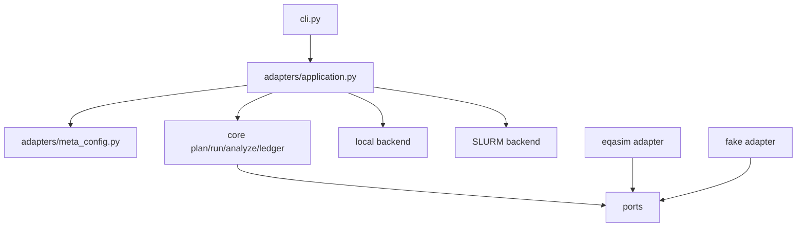

# Development Guide

**English** | [Français](../docs-fr/development-guide.md)

## Architecture

The package follows a ports, core, and adapters separation:

```text
eqasim-sa/
├── pyproject.toml
├── uv.lock
├── src/eqasim_sa/
│   ├── cli.py
│   ├── ports/
│   │   ├── backend.py
│   │   └── simulator.py
│   ├── core/
│   │   ├── plan.py
│   │   ├── run.py
│   │   ├── ledger.py
│   │   ├── charter.py
│   │   ├── campaign_snapshot.py
│   │   ├── analysis_publication.py
│   │   ├── analyze.py
│   │   ├── analyses.py    # analysis-script declarations
│   │   ├── indicators/
│   │   ├── methods/       # per-method plans and analyses
│   │   └── figures/       # plot catalogue and rendering
│   ├── adapters/
│   │   ├── application.py
│   │   ├── meta_config.py
│   │   ├── meta_config_defaults.py
│   │   ├── project_init.py
│   │   ├── checks.py
│   │   ├── estimate.py
│   │   ├── analysis_execution.py
│   │   ├── analysis_runner.py
│   │   ├── plot.py
│   │   ├── data_manifest.py
│   │   ├── worker.py
│   │   ├── backends/
│   │   ├── eqasim/       # adapter, code fingerprint, output files, worker workspace
│   │   └── fake/
│   ├── utils/            # filesystem, platform, Arrow reads, names
│   └── templates/
└── tests/
```

`ports/` defines the backend and simulator protocols. `core/` owns identities,
designs, the ledger, and analyses without knowing about the CLI. `adapters/`
loads YAML, fingerprints the eqasim code, invokes synpp, copies the declared
output files, runs analysis scripts with eqasim's interpreter, manages
local/SLURM execution, and wires the application together. `cli.py` is limited to parsing and JSON
envelopes.

Filesystem responsibilities are deliberately deep: `utils/filesystem.py`
owns stable capture and crash-conscious file commits;
`campaign_snapshot.py` owns coherent plan/run/archive cuts;
`analysis_publication.py` owns immutable analysis generations; and
`adapters/eqasim/workspace.py` owns disposable worker slots and contextual
caches. Callers do not reproduce temporary-name, descriptor, rollback, or
workspace-inventory logic.



## Declared dependencies

| Item | Version/constraint |
| --- | --- |
| Python | `>=3.13,<3.14` |
| pyarrow | `23.0.1` |
| PyYAML | `6.0.3` |
| submitit | `1.5.4` |
| numpy | `2.3.5` |
| pandas | `2.3.3` |
| matplotlib | `3.10.8` |
| scipy | `1.17.1` |
| SALib | `1.5.2` |
| pytest, optional dependency in the `test` extra | `9.0.2` |
| setuptools, build-system requirement only | `>=80` |

The eight libraries between pyarrow and SALib are runtime dependencies. Pandas
and Matplotlib are declared directly and pinned because SALib imports them at
runtime; this prevents transitive resolver drift from changing the numerical
environment. `pytest` is
installed only with the `test` extra; `setuptools>=80` is used to build the
package through `setuptools.build_meta` and is not declared as a runtime
dependency. The package does not install synpp or eqasim. Current scientific
Morris and Sobol designs and analyses use the declared SALib boundary.

## Install and test

From `eqasim-sa/`:

```bash
uv sync --extra test --locked
uv lock --check
uv run --locked pytest
```

Useful targeted tests:

```bash
uv run --locked pytest tests/test_init.py
uv run --locked pytest tests/test_plan.py tests/test_check.py
uv run --locked pytest tests/test_analyze.py tests/test_distribution.py
```

Check the installed commands:

```bash
uv run --locked eqasim-sa --help
uv run --locked eqasim-sa init --help
uv run --locked eqasim-sa-fake-pipeline --help
```

Build distributions from the current source:

```bash
uv build
```

Inspect and test the newly produced artifacts; do not assume that pre-existing
`build/` or `dist/` directories reflect the current source.

## Internal commands

`eqasim-sa` has two internal subcommands, used by the tests and to execute one
isolated run by hand. They are not part of the user workflow: they do not
appear in `eqasim-sa --help` or in the [CLI reference](cli-reference.md).

### `fake-run`

```text
eqasim-sa fake-run --campaign-root PATH --campaign NAME --config JSON \
  --seed INT --expected-context-hash HASH --current-context-hash HASH \
  --workdir PATH
```

`--config` identifies a JSON file. The run is executed by the
`eqasim-sa-fake-pipeline` script, searched next to the Python interpreter, then
on `PATH`. Response: `runId`, `status`, `error`.

### `eqasim-run`

```text
eqasim-sa eqasim-run --campaign-root PATH --campaign NAME \
  --config-yaml PATH --eqasim-root PATH --invocation-json JSON \
  --scratch PATH --seed INT --expected-context-hash HASH \
  --current-context-hash HASH --outputs-json JSON
```

`--invocation-json` must be a JSON array of strings. `--outputs-json` is a JSON
object mapping each declared output name to exactly
`{"file": ..., "separator": ...}` (the `file` may use `{prefix}`), for example
`{"age": {"file": "analysis_population/{prefix}age.csv", "separator": ","}}`;
the run archives exactly these files. Response: `runId`, `status`, `error`.

## Observed testing strategy

- Unit tests for identities, plans, the ledger, indicators, and statistics.
- Adversarial validation tests for Parquet plan and marker schemas, CSV output reading, paths, symbolic links, and atomic writes.
- CLI integration tests with a synpp spy executable.
- A fake pipeline for end-to-end runs and analyses.
- Metadata tests and commands from a built installation.
- The SLURM backend tested with Submitit doubles and reload contracts.
- Interruption, resumption, idempotency, and concurrency tests.

The SLURM tests do not demonstrate operation on a real cluster. The suite is tested
on Linux (Python 3.13: 1558 passed, 4 skipped); the GitHub Actions CI workflow
`.github/workflows/tests.yml` runs it on Ubuntu, macOS, and Windows, and no
Windows or macOS result is claimed until CI has run. Platform test
markers: `posix_only`, `windows_only`, and `linux_only` (slurm backend) are skipped
automatically elsewhere.

Durability note: on macOS, `os.fsync` flushes to the drive but does not force
`F_FULLFSYNC`, so a power loss may still lose the most recent writes held in the
drive cache. eqasim-sa does not issue `F_FULLFSYNC`; atomic publication (complete
or absent) is unaffected.

## Important invariants

- eqasim-sa never calls Git. The eqasim code fingerprint
  (`adapters/eqasim/source_fingerprint.py`) and the bytes of the model YAML are
  sealed in the context and checked again before every run.
- synpp receives the `run:` list of the model YAML unchanged.
- Declared output files are archived byte for byte; only their name, `file`, and
  `separator` are sealed in the plan.
- The plan is reproducible and immutable under a given root.
- The run marker is published after the archives and is the sole proof of completion.
- Plans and run markers are no-clobber publications; an existing marker is never replaced.
- Durable writes are atomic, and symbolic links are broadly rejected.
- Durable campaign coordination is confined to `.eqasim-sa/`; disposable attempts
  and contextual caches are confined to scratch.
- Machine options (`execution.machine_options`) do not modify `runId`.
- Named structured factors remain a separate label-to-list mapping across the
  adapter/core boundary: plans expose labels, resolution and `runId` use lists,
  and schema v3 seals the canonical mapping.
- Scientific designs use version v3; application preflight validates it.
- An analysis must not mutate its sources: indicators read read-only copies, and
  if a captured source (plan, run marker, archive) changes during `analyze`, the
  analysis fails with `selected analysis source changed: <path>` and publishes nothing;
  nothing is restored.
- Every Parquet read goes through `utils/arrow.py` (`read_parquet`, without
  Arrow threads) and CSV reads pass `use_threads=False`: a threaded read can
  hang the process at exit. `tests/test_arrow_threads.py` enforces it.

## Add an indicator kind

The indicator kinds are `tv_distance`, `share`, and `value`, all built in. A user who needs another quantity writes an
[analysis script](analysis-scripts.md) (`analyses`) that returns a table read
by these kinds, or computes it in an eqasim analysis stage, declares the CSV
file under `outputs`, and reads it with `value`.

A new built-in kind is a change to eqasim-sa itself. Implement it in
`core/indicators/` (computation, canonical definition, and `KIND_VERSIONS`),
parse it in `adapters/meta_config.py` (`INDICATOR_KINDS`), and document it in
both YAML references. Changing the bytes of an existing definition requires a
new `eqasim-sa:indicator-definition` domain version. Add tests for parsing,
errors, computation on CSV text columns, and source purity.

## Distribution caveats

Setuptools discovers packages under `src` and includes `templates/*.yml` and
`templates/*.md`. The installed scripts are `eqasim-sa` and
`eqasim-sa-fake-pipeline`; the second one is kept because the internal
`fake-run` command and the distribution tests execute it as an installed
script. The declared Python support is intentionally narrow;
do not broaden it in the documentation without changing and testing the package
contract.
