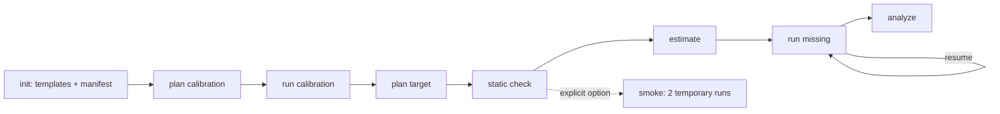

# Workflow and Results

[English](workflow-and-results.md) | [Français](../docs-fr/workflow-and-results.md)

## Lifecycle



`init` prepares configuration templates and hashes the data; it does not enter
the pipeline execution stages. Calibration then provides the duration,
durable storage, and cache observations needed to estimate a target.

## Sealed Identities

`contextHash` is defined as
`SHA-256(b"eqasim-sa:context:v1\0" + UTF8(descriptor))`, where `descriptor` is
the compact JSON with sorted keys for `eqasimCommit`, `dataManifestSha256`,
`lockfileSha256`, and `eqasimSaVersion`. The result is a 64-character lowercase
hexadecimal string. See the
[complete definition](yaml-reference.md#model-and-context).

`runId` consists of the first 32 hexadecimal characters of a SHA-256 over the
canonical configuration and seed. Canonicalization removes
`working_directory`, `data_path`, binaries, Java memory, `output_path`,
`processes`, and `random_seed` from the configuration before hashing, then
carries the seed separately. More precisely, the excluded binaries are
`git_binary`, `java_binary`, and `maven_binary`, and the excluded memory setting
is `java_memory`. `output_prefix` is not excluded, so its value affects `runId`.

`designId` identifies a statistical position, not an execution. It includes
level and replication indices for Grid, or the sealed design role for Morris and
Sobol. Two distinct `designId` values can therefore share a `runId`.

## Positions and Unique Runs

`plan.parquet` contains one row per position. Its fixed columns are:

| Column | Type | Meaning |
| --- | --- | --- |
| `designId` | string | position identity |
| `method` | string | `grid`, `morris`, or `sobol` |
| `role` | string | `point`, trajectory step, or Sobol matrix |
| `runId` | string | deduplicated execution identity |
| `seed` | int64 | eqasim seed |
| `contextHash` | string | scientific context |
| `<factor>` | domain type | projected value of each factor other than seed |

The schema, its metadata, and all rows are recomputed when loading. For Sobol,
the physical row order may vary, but the content indexed by `designId` must be
identical.

## Plan Sealing

`plan` acquires a lock at the campaign-parent level and writes atomically with
Zstandard compression. An identical plan remains unchanged. If `plan.parquet`
exists but differs, or if the root already contains durable state without a
plan, the command refuses to continue. Create a new root instead of editing the
existing one.

## Calibration and Estimation

Each completion marker stores `duration` and `scratchBytes`. For each observed
run, the estimator separately measures durable bytes by adding the size of
the marker and all flat Parquet files in its archive. `estimate` calculates:

- mean observed duration × number of unique runs for compute hours;
- mean durable size × unique runs, plus plan size, for disk space;
- maximum observed `scratchBytes` × number of workers for scratch space.

These are mean extrapolations, not quota or duration guarantees. Observations
from the target that are already complete are also included.

## Storage Trees

```text
campaigns/grid/
├── plan.parquet
├── runs/
│   └── <runId>.parquet
├── archives/
│   └── <runId>/
│       ├── persons.parquet
│       ├── households.parquet
│       ├── activities.parquet
│       ├── trips.parquet
│       ├── vehicle_types.parquet
│       ├── vehicles.parquet
│       ├── age.parquet
│       ├── age_purpose.parquet
│       ├── distance.parquet
│       ├── license.parquet
│       ├── nbr_vehicle.parquet
│       └── travel.parquet
├── logs/
│   └── <runId>.log
├── indicators.parquet
├── replication-dispersion.parquet
└── analysis-generation.json
```

Logs exist only for published failures. The tree shows the six artifacts from
`synthesis.output` and the six additional artifacts when
`analysis.synthesis.population` is requested. Only the stages required by the
indicators are executed, with `synthesis.output` always present.

```text
scratch/eqasim-sa/<campaign>/workers/<slot>/
├── lease.lock
├── state.json
├── cache/
└── attempt-<uuid>/
```

Scratch space contains synpp caches and temporary attempts. It is disposable.

## Completion Marker

`runs/<runId>.parquet` is written last. It contains a single row, compressed
with Zstandard:

| Column | Meaning |
| --- | --- |
| `runId`, `campaign`, `seed`, `contextHash` | expected identity |
| `status` | always `completed` |
| `attempts` | always `1` in the current format |
| `node` | execution node name |
| `duration` | monotonic seconds, finite nonnegative float |
| `scratchBytes` | worker cache size after the run |
| factors | scientific values of the run |

An archive without a marker is incomplete. A marker with the wrong schema, a
different identity, a foreign name, or different compression is an error.
Validation requires a regular, non-symbolic-link file with exactly one row, the
expected schema, no null values, the exact values and types for `runId`,
`campaign`, `seed`, `status: completed`, `attempts: 1`, `contextHash`, and the
factors, a finite nonnegative float `duration`, a nonnegative integer
`scratchBytes`, and Zstandard compression for every column. The `runs/`
directory may not contain any foreign name. The `node` field is a non-null
string validated by the schema. The archive is validated separately by
`estimate` and `analyze`; the marker remains the proof of completion.

## Analysis Outputs

### `indicators.parquet`

| Column | Description |
| --- | --- |
| `runId` | source run |
| `indicator` | resolved indicator name |
| `value` | computed finite float |

### `replication-dispersion.parquet`

Produced when seed is a replication. The factor columns are followed by
`indicator`, `n`, `mean`, `std`, `cv`, `ci95_low`, and `ci95_high`. The interval
uses `mean ± 1.96 × std/√n`; with a single observation, the dispersion statistics
`std`, `cv`, `ci95_low`, and `ci95_high` are null; `n` is 1 and `mean` retains
the observed value.

### `morris-ranking.parquet`

Columns: `indicator`, `factor`, `rank`, `trajectories`, `replications`, `n`,
`mu`, `mu_star`, `sigma`, `seed_std`. Ranking is ordered by descending `mu_star`,
then by factor name.

### `sobol-indices.parquet`

Columns: `indicator`, `factor`, `rank`, `base_sample_size`,
`bootstrap_resamples`, `bootstrap_attempts`, `first_order`,
`first_order_ci_low`, `first_order_ci_high`, `total_order`,
`total_order_ci_low`, `total_order_ci_high`. Ranking follows descending total
order; ties are broken by ascending factor name.

### `analysis-generation.json`

Version 2 manifest containing the SHA-256 values of the outputs, the sensitivity
method, and the `expected`, `completed`, `missing`, and `failed` counts, as well
as `completionRate`.

## Idempotence and Recovery

`run` validates the plan, derives unique runs, validates all present markers, and
submits only missing runs. A rerun after interruption therefore resumes without
recomputing completed runs. A fully complete rerun returns success with
`total: 0`.

Parquet writes use a temporary file, `fsync`, and atomic replacement. `analyze`
backs up sources and outputs before publication and restores them if an indicator
mutates them or if analysis fails.

Never repair state by creating a marker or modifying a plan. Fix the cause,
delete only disposable scratch space if no process is active, then rerun the same
command.

## Workers, Caches, and Leases

Runs are distributed in batches among at most `workers` slots. Each slot
processes its batch serially and reuses its cache. A private lease prevents two
processes from using the same cache. `state.json` is `active` or `clean`; a
missing, invalid, or unclean state causes the cache to be purged before reuse.

A lease per `runId` supplements this protection on SLURM. Caches are never shared
between slots.

## Local and SLURM

The local backend starts batches in parallel within the command process and
interrupts subprocess groups on `Ctrl-C`. The SLURM backend uses Submitit, a job
array, and `slurm_array_parallelism=workers`; each job reloads the
meta-configuration and rechecks its SHA-256 and the `contextHash`.

The code and tests cover construction and simulated behavior of the SLURM
backend. They do not constitute validation on a real SLURM cluster.

See the [glossary](glossary.md) for identity and storage terminology.
