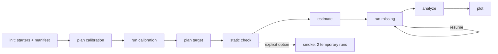

# Workflow and Results

[English](workflow-and-results.md) | [Français](../docs-fr/workflow-and-results.md)

## Lifecycle



`init` writes the starter configurations and hashes the data; it does not enter
the pipeline execution stages. Calibration then provides the duration,
durable storage, and cache observations needed to estimate a target.
`analyze` can be run again at any time after the runs, for example with new
[analysis scripts](#analysis-scripts); it never modifies the plan or the run
archives.

## Sealed Identities

`contextHash` is defined as
`SHA-256(b"eqasim-sa:context:v3\0" + ASCII(descriptor))`, where `descriptor` is
the compact JSON with sorted keys for `eqasimSourceSha256` (the eqasim code
fingerprint, computed without Git), `dataManifestSha256`, `lockfileSha256`, and
`eqasimSaVersion`. The result is a 64-character lowercase
hexadecimal string. See the
[complete definition](yaml-reference.md#the-eqasim-code-fingerprint).

The plan also seals the declared outputs (`outputsDeclaration`): for each
output, its name, `file`, and `separator`. These determine what each run
archives. The columns read by indicators (`category`, `simulated`,
`references`) and the indicators themselves are not sealed: they are read from
the current meta-configuration at every `analyze`.

The plan also seals the eqasim configuration (`modelDocument`): the compact
JSON, with sorted keys, of the base configuration without the keys excluded
from `runId` (listed below) and without `random_seed`. A machine-only edit
(`data_path`, `processes`...) therefore changes neither the plan nor the
resumption of `run`. `analyze` rebuilds the runs from what the plan sealed
(`modelDocument` and context) and checks the factors, the `run:` stages,
`output_formats`, and `output_prefix` of the meta-configuration against
`modelDocument`, not against the current eqasim folder: editing the eqasim
code, configuration, or `uv.lock` after the runs does not block `analyze`,
while `run` still refuses to resume. A plan without `modelDocument` is
refused.

`runId` consists of the first 32 hexadecimal characters of a SHA-256 over the
canonical configuration and seed. Canonicalization removes
`working_directory`, `data_path`, binaries, Java memory, `output_path`,
`processes`, and `random_seed` from the configuration before hashing, then
carries the seed separately. More precisely, the excluded binaries are
`git_binary`, `java_binary`, and `maven_binary`, and the excluded memory setting
is `java_memory`. `output_prefix` is not excluded, so its value affects `runId`.

`designId` identifies a statistical position, not an execution. It includes
level and replication indices for Grid, or the sealed design role for
discrete OAT, canonical Morris, Sobol, and multi-scramble Sobol. Two distinct `designId` values
can therefore share a `runId`.

## Positions and Unique Runs

`plan.parquet` contains one row per position. Its fixed columns are:

| Column | Type | Meaning |
| --- | --- | --- |
| `designId` | string | position identity |
| `method` | string | `grid`, `discrete_oat`, `canonical_morris`, `sobol`, or `multiscramble_sobol` |
| `role` | string | `point`, trajectory step, or Sobol matrix |
| `runId` | string | deduplicated execution identity |
| `seed` | int64 | eqasim seed |
| `contextHash` | string | scientific context |
| `<factor>` | domain type | projected value of each factor other than seed |

Adjacent-level demonstrations use `discrete_oat`; scientific screening uses
`canonical_morris`. Unstructured plans of the two scientific methods (canonical
Morris and multi-scramble Sobol) have `planSchemaVersion: 2` and seal the
normalized scientific contract and complete design/analysis definition. Other
unstructured plans use plan schema v1. Any supported
design with named structured-list factors uses schema v3 and seals canonical
structured metadata v1; its factor column stores labels while `runId` hashes the
resolved ordered list.

The schema, its metadata, and all rows are recomputed when loading. For Sobol,
the physical row order may vary, but the content indexed by `designId` must be
identical.

## Plan Sealing

`plan` publishes `plan.parquet` exclusively, without a parent-level lock, and
uses Zstandard compression. Concurrent equivalent plans resolve to one created
file and one unchanged result; no invocation can replace the winner. If `plan.parquet`
exists but differs, or if the root already contains durable state without a
plan, the command refuses to continue. Create a new root instead of editing the
existing one.

## Calibration and Estimation

Each completion marker stores `duration` and `scratchBytes`. For each observed
run, the estimator separately measures durable bytes by adding the size of
the marker and all files in its archive. `estimate` calculates:

- mean observed duration × number of unique runs for compute hours;
- mean durable size × unique runs, plus plan size, for disk space;
- maximum observed `scratchBytes` × number of workers for scratch space.

These are mean extrapolations, not quota or duration guarantees. Observations
from the target that are already complete are also included. Every campaign
involved must have been planned, otherwise `estimate` and `check` stop with
`campaign <campaign> has no plan yet: run plan first`; and at least one run must
be complete, otherwise `estimate` stops with, for example,
`no completed calibration run yet: run the calibration campaign
mon-analyse-sa-calibration first`. The result also
gives the number of design positions as a formula of the method (`formula`,
`formulaInputs`; see the [CLI reference](cli-reference.md#estimate)).

## Storage Trees

```text
campaigns/mon-analyse-sa-grid/
├── plan.parquet
├── runs/
│   └── <runId>.parquet
├── archives/
│   └── <runId>/
│       ├── persons.csv
│       ├── households.csv
│       ├── trips.csv
│       ├── activities.csv
│       ├── vehicle_types.csv
│       ├── vehicles.csv
│       ├── activities_spatial.gpkg
│       ├── homes_spatial.gpkg
│       ├── commutes_spatial.gpkg
│       ├── trips_spatial.gpkg
│       ├── age.csv
│       ├── distance.csv
│       └── nbr_vehicle.csv
├── logs/
│   └── <runId>.log
├── .eqasim-sa/
│   ├── locks/
│   │   ├── runs/<runId>.lock
│   │   ├── analysis.lock
│   │   └── slurm.lock
│   ├── transactions/
│   └── slurm/
│       ├── submission-intent.json  # only while submission outcome is unproved
│       ├── active-jobs.json  # present only while jobs are owned
│       └── submitit/
├── analyses-cache/  # recomputable results of analysis scripts
│   ├── <analysis>/
│   │   ├── <fingerprint>.csv
│   │   └── <fingerprint>.sha256
│   └── logs/<analysis>-<runId>.log
├── analysis/
│   ├── staging/
│   └── generations/
│       └── <generationId>/
│           ├── captured-run-set.json
│           ├── indicators.parquet
│           ├── replication-dispersion.parquet
│           ├── output-summary.parquet
│           ├── convergence-evidence.parquet  # scientific methods only
│           └── governed-report.json
├── analysis-generation.json
└── figures/  # written by `plot`, not part of the sealed generation
    └── <generationId>/
        ├── figures.json
        └── <figure>[-<indicator>].png
```

Logs exist only for published failures. The archive holds one file per output
declared in the meta-configuration, here the eight outputs of the starters. Each
file is a byte-for-byte copy of what eqasim wrote, named
`<output name><extension>`; files that are not declared are not kept. eqasim
runs the `run:` list of your eqasim configuration unchanged, so that list must
contain the stages that write the declared files.
Final analysis outputs live in one immutable
`analysis/generations/<generationId>/` directory. `analysis/staging/` contains
only transactional work and is empty after a normal command completes.
`analyses-cache/` holds the results of [analysis scripts](#analysis-scripts)
and their error logs; it can be deleted when no command is running (see
[Cleaning up](#cleaning-up)).
`.eqasim-sa/` contains durable technical coordination local to this campaign:
module-private leases, same-filesystem run transactions, and Submitit state.
It is not scratch, but it disappears with the campaign and is never created in
the campaign parent. A rerun of `init` refuses a campaign containing anything
it does not recognize, for example `.submitit`, `.eqasim-sa-tmp`, or
`.eqasim-sa-run-locks`, with
`foreign content in init campaign <campaign>: <entry>`.

```text
scratch/                      # execution.scratch
├── esa/
│   └── <campaign>/
│       └── w<slot>/          # one per worker slot: w0, w1, ...
│           ├── lease.lock    # private lease of the slot
│           ├── c<hash>.json  # campaign and full contextHash of the cache
│           ├── s<hash>.json  # cache state: active or clean
│           ├── c<hash>/      # synpp working directory (eqasim's cache)
│           └── a<12 hex>/    # one attempt: a run in progress, or a failed run
│               ├── config.yml
│               ├── run.log
│               ├── output/
│               └── collected/
└── .smoke-<8 hex>/           # only while check --smoke runs
```

`<hash>` is the first 12 hexadecimal characters of the campaign's
`contextHash`; names are kept short so that eqasim's own deep paths fit the
Windows 260-character limit (see the `path_length` check in the
[CLI reference](cli-reference.md#check)). An attempt directory holds the eqasim
configuration written for the run, its log, eqasim's output folder, and the
copies of the declared outputs before archiving. eqasim-sa deletes the attempt
directory once the run is archived; the attempt of a failed run stays, and its
log is copied to `<campaign_root>/logs/<runId>.log`. The scratch space is
disposable: see [Cleaning up](#cleaning-up).

## Figures

`eqasim-sa plot` draws figures from the published analysis generation. It reads
`analysis-generation.json`, checks the sha256 of every published output (table
or JSON document) before reading it, and writes PNG files plus an index `figures.json` to
`figures/<generationId>/`. It does not read the runs; it only checks the
meta-configuration against the sealed plan, so `plot` needs the campaign's
meta-configuration and sealed plan. It writes nothing under `analysis/`. The figures are not part of the sealed generation and
can be deleted and recreated. Each run rebuilds
`figures/<generationId>/` as a whole, so no stale file remains; the directories
of other generations are left untouched. A new `analyze` publication gets its own
directory.

You never choose what a figure means: a figure is drawn only if it is valid for
the method that was analyzed and if the tables it needs were published. Asking
for any other figure with `--figure` is an error that lists the valid ones.
Without `--figure`, every valid figure is drawn. In `--descriptive-only` mode
no sensitivity table exists, so only `output-summary` remains, plus `grid-response` for a `grid`
campaign whose dispersion table is published.

| Figure | Method | Needs | What it shows |
| --- | --- | --- | --- |
| `output-summary` | all | `output-summary.parquet` | One axis row per indicator, each with its own x scale: median, q05 to q95 and min to max. Captioned "median, q05–q95 and min–max: distribution over plan positions", never model uncertainty. Indicators with no median are listed on the figure ("not plotted: ..."). |
| `grid-response` | `grid` | `replication-dispersion.parquet`, at least one numeric parameter | One figure per indicator, one subplot per numeric parameter used as x, one line per combination of the other parameters (never averaged), with the published 95% CI between replications, drawn only when both bounds exist. A point with a single replication has no interval segment; when every point of the indicator has a single replication, the subplot title says "1 replication, no CI" (otherwise "mean ± 95% CI across replications"). Without a numeric parameter the figure is skipped (listed under `skipped` in `figures.json`), or the command fails if you requested it explicitly. |
| `oat-effects` | `discrete_oat` | sensitivity table | Bars of `mu_star` per factor, `sigma` as a marker, `seed_std` as a reference tick. Titled "local normalized OAT effects, not global". Factors without `mu_star` are omitted and listed. |
| `sobol-indices` | `sobol` | sensitivity table | Grouped `first_order` and `total_order` bars with the bootstrap CI. Carries the banner "demonstration: single scramble, non-inferential CIs". |
| `morris-plane` | `canonical_morris` | sensitivity table | The mu*-sigma plane, the CI of `mu_star` as horizontal bars, and the diagonal sigma = mu*. A factor without a finite `sigma` or `mu_star` is omitted and listed. |
| `morris-convergence` | `canonical_morris` | convergence table | `mu_star` and its CI along `checkpoint_trajectories`, one line per factor. |
| `morris-rank-reversals` | `canonical_morris` | rank-reversal table | A `factor_a` by `factor_b` map of the probability that the published order of the pair is reversed, at the last checkpoint. Shown as n/a when no probability is published for the pair (for example a tie). |
| `morris-noise-floor` | `canonical_morris` | `noise-floor.parquet` | Two separate series per trajectory and rank: the intrinsic standard deviation and the Monte Carlo standard error of the mean (not sd +/- mcse). `replication-allocation.json` is published in the pilot phase only; when it is, and its `targetMcse` is finite, the `targetMcse` reference line is drawn on the figure of its `primaryIndicator` only. |
| `multiscramble-indices` | `multiscramble_sobol` | sensitivity table | `first_order_mean` and `total_order_mean` with their CI at the last checkpoint, that is the largest base sample size N (the title gives N and the number of scrambles). Each actionable factor shows its rank, and the title states the ranking rule of the objective: for `ff`, increasing upper CI bound of the total order (rank 1 = best candidate to fix); for `fp`, decreasing mean first order (rank 1 = most influential factor). Tied factors share their average rank, printed as is (for example 2.5). Non-actionable factors (the seed factor) are grey, hatched, placed apart, and show no rank. |
| `multiscramble-convergence` | `multiscramble_sobol` | convergence table, governed report | The CI width against the base sample size N of each checkpoint (the number of scrambles stays fixed), per actionable factor, of the order that matches the objective (first order for `fp`, total order for `ff`), plus the maximum over the actionable factors. The seed factor is grey and excluded from that maximum. The stopping criterion reads the primary indicator only: there the maximum is labelled as the criterion and the `ci_width` threshold is drawn when the governed report defines one; on the other indicators the curve is only labelled "max over actionable factors", with no threshold. |
| `multiscramble-by-scramble` | `multiscramble_sobol` | by-scramble table | One point per scramble and per factor, at the last checkpoint (the largest base sample size N, given in the title). |

Every confidence interval is drawn exactly as published, never clamped, even
when a bootstrap interval does not contain its estimate. Every figure carries a
foot line `method · inferenceStatus · claimAuthorized=<true|false> · reasonCodes ·
generation <first 12 characters>`, with `claimAuthorized` read from the governed
report (currently always `false`) and the reason codes other than the status
itself (`none` when the report lists none; the `reasonCodes` slot and its
separator are left out when the status is the only code listed), wrapped onto
several lines when it is too
long for the figure width, and a red "incomplete campaign" banner when the
status is `incomplete_noninferential`. An axis label longer than its axes (a
long indicator name, for example) is wrapped onto several lines, so it stays
within the axes. With several indicators, the primary
indicator of the charter decision (`decision.primary_indicator` in the governed
report) comes first, then the others in alphabetical order; without a charter
decision, the indicators flagged by the table's `is_primary_indicator` column,
when it has one, come first; otherwise the order is alphabetical. Files are named `<figure>-<indicator>.png`;
`output-summary.png` has no indicator suffix. In the file name, every character
of the indicator outside `[A-Za-z0-9_-]` becomes `_` (for example
`grid-response-tv_distance_age__ref_reference_.png`). If two figures would get
the same file name, the command fails before anything is written.

`figures.json` holds `generationId`, `method`, `inferenceStatus`, `figures` (each
with `name`, `indicator`, `file`, `sources`, the role and sha256 of every
published output the figure is drawn from, not only tables: `governedReport`
(the stamp) is always listed, and `replicationAllocation` when its target line
is drawn; and `omitted`, what could not be drawn) and `skipped` (figures skipped
with their `reason`).

## Completion Marker

`runs/<runId>.parquet` is written last. It contains a single row, compressed
with Zstandard:

| Column | Meaning |
| --- | --- |
| `runId`, `campaign`, `seed`, `contextHash` | expected identity |
| `status` | always `completed` |
| `attempts` | always `1` in the current format |
| `node` | execution node name |
| `duration` | monotonic seconds, finite nonnegative float |
| `scratchBytes` | worker cache size after the run |
| factors | scientific values of the run |

The marker also carries two metadata entries. `artifactManifest` lists every
archived file with its output `name`, its `sourcePath` (the original path under
eqasim's output folder, for example `analysis_population/nantes_age.csv`), its
size, and its SHA-256. `executionEvidence` (schema version 3) records how the
run was executed, including the eqasim code fingerprint (`modelSourceSha256`).

An archive without a marker is incomplete. A marker with the wrong schema, a
different identity, a foreign name, or different compression is an error.
Validation requires a regular, non-symbolic-link file with exactly one row, the
expected schema, no null values, the exact values and types for `runId`,
`campaign`, `seed`, `status: completed`, `attempts: 1`, `contextHash`, and the
factors, a finite nonnegative float `duration`, a nonnegative integer
`scratchBytes`, and Zstandard compression for every column. The `runs/`
directory may not contain any foreign name. The `node` field is a non-null
string validated by the schema. The archive is validated separately by
`estimate` and `analyze`; the marker remains the proof of completion.

## Analysis Outputs

### `indicators.parquet`

| Column | Description |
| --- | --- |
| `runId` | source run |
| `indicator` | resolved indicator name |
| `value` | computed finite float |

### `replication-dispersion.parquet`

Produced when seed is a replication. The factor columns are followed by
`indicator`, `n`, `mean`, `std`, `cv`, `ci95_low`, and `ci95_high`. The interval
uses `mean ± 1.96 × std/√n`; with a single observation, the dispersion statistics
`std`, `cv`, `ci95_low`, and `ci95_high` are null; `n` is 1 and `mean` retains
the observed value.

### `output-summary.parquet`

Produced for every analysis. For each indicator it reports `n`, `mean`, the
unbiased `standardDeviation`, `minimum`, linear `q05`, `median`, linear `q95`,
and `maximum`. Values are joined back to every row of `plan.parquet`, so
structurally duplicated design positions retain their design weight instead of
being collapsed to unique run IDs.

### `discrete-oat-effects.parquet`

Produced for `method: discrete_oat`. It has the columns `indicator`, `factor`, integer `rank`, `trajectories`,
`replications`, `n`, `mu`, `mu_star`, nullable `sigma`, and nullable `seed_std`.
Effects use adjacent numeric levels and each local step normalized by the full
declared factor range. This demonstration output is not canonical Morris, does
not estimate variance shares, and does not justify factor fixing.

### `canonical-morris-ranking.parquet`

Produced for the final checkpoint of `method: canonical_morris`. Columns are:
`indicator`, `factor`, float `rank`, `rank_ci_low`, `rank_ci_high`,
`top_k_probability`, `trajectories`, `replications`, `elementary_effects`,
`delta`, `mu`, `mu_star`, `mu_star_ci_low`, `mu_star_ci_high`, nullable `sigma`,
nullable `seed_std`, `bootstrap_resamples`, and `confidence_level`.

Effects are averaged over the `R` replications within each trajectory before
the estimates are computed across `T` trajectory means. Consequently,
`elementary_effects` records the computed count `T*R`, while `T` trajectories,
not `T*R` effects, are the effective bootstrap units. `seed_std` is the root
mean square of within-trajectory sample variances over seeds and is null when
`R=1`; current scientific charters require `R>=2`.

Point ranks are floats because exact `mu_star` ties receive their average rank.
Each bootstrap replicate uses the same average-rank rule. If a tied group crosses
the declared top-k boundary, the remaining top-k slots are split fractionally
within that group; `top_k_probability` averages those fractional allocations.
`mu_star` interval endpoints use NumPy's default linear quantiles. Rank interval
endpoints use empirical `lower` and `higher` quantiles so observed rank support
is respected.

### `canonical-morris-convergence.parquet`

Contains the same columns and calculations as the ranking table, replacing
`trajectories` with `checkpoint_trajectories`, for every declared checkpoint.
Checkpoint rows feed the separately published governed convergence evidence.

### `canonical-morris-rank-reversals.parquet`

Columns: `indicator`, `checkpoint_trajectories`, `factor_a`, `factor_b`,
`point_order`, nullable `reversal_probability`, `tie_probability`, and
`bootstrap_resamples`. Pairs follow descending point `mu_star`. `point_order` is
1 for that strict point ordering and 0 for a point tie. On a point tie,
`reversal_probability` is null because neither direction is privileged;
`tie_probability` still reports the bootstrap equality frequency. Otherwise,
reversal probability is the fraction of trajectory-bootstrap replicates in
which `factor_a` has lower `mu_star` than `factor_b`.

The canonical trajectory bootstrap provides finite-design uncertainty evidence
conditional on the declared and sealed scientific-screening contract. These
tables do not by themselves provide calibrated decision evidence or FP/FF claims.

### `noise-floor.parquet` and `replication-allocation.json`

Every canonical analysis publishes the strict columns `indicator`, `trajectory`,
`rank`, `role`, `replications`, `mean`, `intrinsic_variance`, `intrinsic_sd`,
`mcse`, and `is_primary_indicator`. The unbiased pointwise variance is in squared
indicator units; SD, mean, and MCSE are in indicator units. Replications are
descriptive and are never bootstrapped as trajectories.

Only a pilot publishes `replication-allocation.json`. It records the quantile and
its value, target MCSE, raw/selected/current counts, structural production
positions, exact non-reserve available runs, `withinTarget`, and seed policy.
Status is `recommended`, `capped`, or `infeasible`; none authorizes mutation of
the pilot. Create a new production root, set `phase: production`, copy the
selected count, and cite the pilot output as provenance. Production publishes
the noise floor without a recommendation.

### `sobol-indices.parquet`

Columns: `indicator`, `factor`, `rank`, `base_sample_size`,
`bootstrap_resamples`, `bootstrap_attempts`, `first_order`,
`first_order_ci_low`, `first_order_ci_high`, `total_order`,
`total_order_ci_low`, `total_order_ci_high`. Ranking follows descending total
order; ties are broken by ascending factor name.

This file belongs to demonstration `method: sobol`, whose row bootstrap remains a
demonstration-only uncertainty calculation. Its analysis manifest contains
`inferenceStatus: demonstration_noninferential`.

### Multi-scramble Sobol outputs

`method: multiscramble_sobol` publishes four files transactionally. The final
aggregate and tie-aware objective rank are in
`multiscramble-sobol-indices.parquet`. Per-scramble estimates at every declared
checkpoint, including effective contrasts, variance, `ST_minus_S`, and
out-of-range flags, are in `multiscramble-sobol-by-scramble.parquet`.
`multiscramble-sobol-convergence.parquet` contains between-scramble means, sample
SD, SE, two-sided Student-t intervals, widths, checkpoint changes, rank, objective,
`is_primary_indicator`, non-null `is_actionable`, and the nullable FF tolerance classification. Raw Sobol
estimates are not clipped.
`multiscramble-sobol-diagnostics.parquet` reports sums, out-of-range and negative
gap counts, design positions, unique run IDs, duplicate fraction, and maximum
multiplicity for each indicator, scramble, and checkpoint. Duplicated run IDs
are valid discrete-projection reuse, not duplicated QMC evidence.

All source indicator values must be finite. Sobol estimation centers and scales
the complete A/B/hybrid arrays before calling SALib, then reports
`output_variance` in the indicator's original squared units. Constant base
variance, loss of base variance at `float64` precision, a non-finite index, or an
original-scale variance outside the representable `float64` range aborts the
transaction. The analyzer does not clip values, discard a scramble, or publish
the remaining tables.

FP ranks descending aggregate first-order means. FF ranks ascending total-order
upper confidence bounds for every indicator, but only the sealed primary
indicator receives `within_practical_tolerance`: seed is non-actionable with null
rank and tolerance, and ordinary factors compare their total-order upper Student bound with the declared
tolerance. FP rows and FF secondary-indicator rows contain `null`. Secondary
indicators are diagnostics and cannot carry an FF decision classification. A
convergence row is evidence only; the sealed criterion is evaluated in
`convergence-evidence.parquet`.

### `convergence-evidence.parquet` and `governed-report.json`

Scientific methods publish `metric`, nullable `checkpoint` and `value`,
`threshold`, `passed`, `consecutivePasses`, `criterionMet`, and
`evaluationStatus`. Canonical Morris `rank_stability` is the maximum absolute
primary-indicator rank change over actionable factors divided by `max(1,D-1)`,
starting after the first checkpoint. Multi-scramble Sobol `ci_width` is the
maximum actionable-factor first-order width for FP or total-order width for FF.
The final consecutive-pass count must reach the sealed requirement. Unsupported,
incomplete, or non-finite evidence fails closed.

`governed-report.json` records the sealed decision, evidence hashes, exclusions,
non-actionable factors, objective-compatible factor evidence, criterion states,
pending robustness checks, inference status, reason codes, and
`claimAuthorized`. Demonstrations, including demonstration Sobol, report
`demonstration_noninferential`, and canonical pilots report
`pilot_only`. Scientific production reports `unstable` until stopping passes,
then `conditional` while robustness remains pending. Under the current contract
no report is `robust` and `claimAuthorized` remains false. FF evidence is limited
to the sealed primary indicator and uses total-order upper bounds.

### `analysis-generation.json`

The version 8 manifest is the atomically replaced pointer to the current
immutable generation. Its `layout` remains `immutable-generation-v1`;
`generationPath` selects `analysis/generations/<generationId>` and every output
record carries its relative path, size, and SHA-256. Method-specific artifacts
remain in that generation with their hashes.
Publication remains transactional.

For scientific methods, the application adapter recomputes the design from the
meta-configuration and the eqasim configuration sealed in the plan
(`modelDocument`), and validates every run identity before invoking core
analysis. Standalone core analysis cannot recompute run IDs because it does not
receive the base model configuration; full-context run identity is therefore an
adapter preflight, not a weaker core heuristic.

`captured-run-set.json` (schema version 2) lists the runs read by the
analysis; each run carries an `analyses` mapping, empty when no indicator reads
an analysis output. The manifest repeats these records under
`provenance.analyses`, by analysis then by `runId`.

## Analysis Scripts

An analysis script, declared under
[`analyses`](yaml-reference.md#analyses), computes an analysis output from the
archived files of each run; the guide
[Writing an analysis script](analysis-scripts.md) explains how to write one.
`analyze` runs only the analyses read by at least one indicator, after it has
captured and verified the run archives, under the `analysis.lock` lease. Each
script runs in a separate process with eqasim's interpreter, on copies of the
archived inputs; the archives and the plan are never modified. Up to
`execution.workers` scripts run at once. Any script error fails the whole
analysis, even with `completeness_threshold` below 1, with
`analysis '<name>' failed for run <runId>: <last line of the error>`; the full
error output is in `analyses-cache/logs/<name>-<runId>.log`.

Each result is identified by its fingerprint, a SHA-256 under domain
`eqasim-sa:analysis-result:v1` of the analysis name, the script SHA-256 (line
endings normalized), the SHA-256 of each input, the run parameters
(`runId`, `seed`, `factors`), and the environment fingerprint. The environment
fingerprint is a SHA-256 of the Python, pandas, numpy, pyarrow, geopandas,
shapely, and pyogrio versions reported by the interpreter and of the SHA-256
of `uv.lock` in the eqasim folder, measured once per `analyze`. Results are cached in
`analyses-cache/<analysis>/<fingerprint>.csv`, published atomically after
`<fingerprint>.sha256`. A result whose fingerprint is cached is reused; an
altered entry is removed, recomputed, and reported in the `warnings` field of
the `analyze` result; its `analyses` field counts, per analysis, the results
computed and those read from the cache. Deleting the cache loses nothing.

For every analysis output and every run, the published analysis records the
result fingerprint, the script SHA-256, the environment fingerprint, the
SHA-256 of each input, and the SHA-256 and size of the result; the reported
versions are recorded once per analysis in `provenance.analysisEnvironments`.
Indicators
reading an analysis output describe it by `{name, analysis, inputs,
separator}` in their definition (domain `eqasim-sa:indicator-definition:v4`).
A scientific charter's `primary_indicator` cannot read an analysis output.

A typical sequence: plan and run the campaign on a cluster, copy the campaign
folder back, add scripts and the indicators that read them to the
meta-configuration, then run `analyze`. Because `analyze` checks the
meta-configuration against what the plan sealed, eqasim may change on the
analyzing machine; `check` does not run the scripts (its smoke runs skip the
indicators reading analysis outputs), so a broken script appears only at
`analyze`.

## Idempotence and Recovery

`run` validates the plan, derives unique runs, validates all present markers, and
submits only missing runs. A rerun after interruption therefore resumes without
recomputing completed runs. A fully complete rerun returns success with
`total: 0`.

Durable writes use same-filesystem staging, `fsync`, and either exclusive
creation or restorable replacement. `analyze` captures a stable campaign cut,
serializes into its private generation transaction, and moves the pointer only
after revalidating every selected source.

Never repair state by creating a marker or modifying a plan. Fix the cause,
delete only disposable scratch space if no process is active, then rerun the same
command.

## Workers, Caches, and Leases

Runs are distributed in batches among at most `workers` slots. Each slot
processes its batch serially and reuses its cache. A private lease prevents two
processes from using the same cache. `s<hash>.json` is `active` or `clean`; a
missing, invalid, or unclean state causes the cache to be purged before reuse.

A lease per `runId` supplements this protection across invocations. Analysis
publication and SLURM journal ownership each have a separate module-private
lease. There is no campaign-wide orchestration lock. Caches are never shared
between slots or contexts.

## Cleaning up

eqasim-sa never deletes a campaign's scratch tree, the analysis cache, or an
analysis generation on its own. It removes only these: the attempt directory
of a run once it is archived; the `.smoke-<8 hex>/` directory of
`check --smoke`; a slot's synpp cache `c<hash>/`, before reusing the slot,
when its state file is missing, invalid, or not `clean`, or when the cache
directory is invalid; the transaction work under `analysis/staging/`; and an
altered analysis cache entry before recomputing it. Everything else accumulates until you
delete it. Delete only when no `run`, `check --smoke`, or `analyze` command is
running on the campaign.

| What | When it can be deleted | Consequence |
| --- | --- | --- |
| `<execution.scratch>/esa/<campaign>/` (or all of `esa/`) | once the campaign's runs are finished, or after a failure | nothing is lost; the next run of that campaign rebuilds the synpp cache of each slot, so its first run per slot is slower. Keep the `execution.scratch` folder itself: it must exist |
| `analyses-cache/` (whole, or one `analyses-cache/<analysis>/`) | at any time | nothing is lost; the next `analyze` reruns the scripts for every run |
| `analysis/generations/<generationId>/` other than the current one | at any time | removes an old analysis result. Delete the whole directory, never part of it |

The current generation is the one named by `generationPath` in
`analysis-generation.json`; never delete it. Each `analyze` whose result
differs publishes a new generation and leaves the previous ones in place.
Never delete `plan.parquet`, `runs/`, `archives/`, `analysis-generation.json`,
or `.eqasim-sa/`: they are the campaign itself.

## Local and SLURM

The local backend starts batches in parallel within the command process and
interrupts subprocess groups on `Ctrl-C`. The SLURM backend uses Submitit, a job
array, and `slurm_array_parallelism=workers`; each job reloads the
meta-configuration and rechecks its SHA-256 and the `contextHash`.
Submitit files and the active-job journal live under
`<campaign>/.eqasim-sa/slurm/`; no scheduler files are written beside scientific
campaign outputs. A durable submission intent is written before contacting the
scheduler. If the scheduler reply is lost, that intent blocks automatic retry
until an operator verifies the scheduler, preventing duplicate arrays. The
journal recovers interrupted temporary hard links.

The code and tests cover construction and simulated behavior of the SLURM
backend. They do not constitute validation on a real SLURM cluster.

See the [glossary](glossary.md) for identity and storage terminology.
