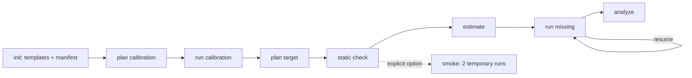

# Workflow and Results

[English](workflow-and-results.md) | [Français](../docs-fr/workflow-and-results.md)

## Lifecycle



`init` prepares configuration templates and hashes the data; it does not enter
the pipeline execution stages. Calibration then provides the duration,
durable storage, and cache observations needed to estimate a target.

## Sealed Identities

`contextHash` is defined as
`SHA-256(b"eqasim-sa:context:v1\0" + UTF8(descriptor))`, where `descriptor` is
the compact JSON with sorted keys for `eqasimCommit`, `dataManifestSha256`,
`lockfileSha256`, and `eqasimSaVersion`. The result is a 64-character lowercase
hexadecimal string. See the
[complete definition](yaml-reference.md#model-and-context).

`runId` consists of the first 32 hexadecimal characters of a SHA-256 over the
canonical configuration and seed. Canonicalization removes
`working_directory`, `data_path`, binaries, Java memory, `output_path`,
`processes`, and `random_seed` from the configuration before hashing, then
carries the seed separately. More precisely, the excluded binaries are
`git_binary`, `java_binary`, and `maven_binary`, and the excluded memory setting
is `java_memory`. `output_prefix` is not excluded, so its value affects `runId`.

`designId` identifies a statistical position, not an execution. It includes
level and replication indices for Grid, or the sealed design role for historical
Morris, discrete OAT, canonical Morris, and Sobol. Two distinct `designId` values
can therefore share a `runId`.

## Positions and Unique Runs

`plan.parquet` contains one row per position. Its fixed columns are:

| Column | Type | Meaning |
| --- | --- | --- |
| `designId` | string | position identity |
| `method` | string | `grid`, legacy `morris`, `discrete_oat`, `canonical_morris`, or `sobol` |
| `role` | string | `point`, trajectory step, or Sobol matrix |
| `runId` | string | deduplicated execution identity |
| `seed` | int64 | eqasim seed |
| `contextHash` | string | scientific context |
| `<factor>` | domain type | projected value of each factor other than seed |

Historical `morris` is readable legacy demonstration provenance only. New
adjacent-level demonstrations use `discrete_oat`; scientific screening uses
`canonical_morris`. Canonical Morris plans have `planSchemaVersion: 2` and seal
the normalized scientific contract and complete design/analysis definition.
Other current and legacy plans use plan schema v1.

The schema, its metadata, and all rows are recomputed when loading. For Sobol,
the physical row order may vary, but the content indexed by `designId` must be
identical.

## Plan Sealing

`plan` acquires a lock at the campaign-parent level and writes atomically with
Zstandard compression. An identical plan remains unchanged. If `plan.parquet`
exists but differs, or if the root already contains durable state without a
plan, the command refuses to continue. Create a new root instead of editing the
existing one.

## Calibration and Estimation

Each completion marker stores `duration` and `scratchBytes`. For each observed
run, the estimator separately measures durable bytes by adding the size of
the marker and all flat Parquet files in its archive. `estimate` calculates:

- mean observed duration × number of unique runs for compute hours;
- mean durable size × unique runs, plus plan size, for disk space;
- maximum observed `scratchBytes` × number of workers for scratch space.

These are mean extrapolations, not quota or duration guarantees. Observations
from the target that are already complete are also included.

## Storage Trees

```text
campaigns/grid/
├── plan.parquet
├── runs/
│   └── <runId>.parquet
├── archives/
│   └── <runId>/
│       ├── persons.parquet
│       ├── households.parquet
│       ├── activities.parquet
│       ├── trips.parquet
│       ├── vehicle_types.parquet
│       ├── vehicles.parquet
│       ├── age.parquet
│       ├── age_purpose.parquet
│       ├── distance.parquet
│       ├── license.parquet
│       ├── nbr_vehicle.parquet
│       └── travel.parquet
├── logs/
│   └── <runId>.log
├── indicators.parquet
├── replication-dispersion.parquet
└── analysis-generation.json
```

Logs exist only for published failures. The tree shows the six artifacts from
`synthesis.output` and the six additional artifacts when
`analysis.synthesis.population` is requested. Only the stages required by the
indicators are executed, with `synthesis.output` always present.

```text
scratch/eqasim-sa/<campaign>/workers/<slot>/
├── lease.lock
├── state.json
├── cache/
└── attempt-<uuid>/
```

Scratch space contains synpp caches and temporary attempts. It is disposable.

## Completion Marker

`runs/<runId>.parquet` is written last. It contains a single row, compressed
with Zstandard:

| Column | Meaning |
| --- | --- |
| `runId`, `campaign`, `seed`, `contextHash` | expected identity |
| `status` | always `completed` |
| `attempts` | always `1` in the current format |
| `node` | execution node name |
| `duration` | monotonic seconds, finite nonnegative float |
| `scratchBytes` | worker cache size after the run |
| factors | scientific values of the run |

An archive without a marker is incomplete. A marker with the wrong schema, a
different identity, a foreign name, or different compression is an error.
Validation requires a regular, non-symbolic-link file with exactly one row, the
expected schema, no null values, the exact values and types for `runId`,
`campaign`, `seed`, `status: completed`, `attempts: 1`, `contextHash`, and the
factors, a finite nonnegative float `duration`, a nonnegative integer
`scratchBytes`, and Zstandard compression for every column. The `runs/`
directory may not contain any foreign name. The `node` field is a non-null
string validated by the schema. The archive is validated separately by
`estimate` and `analyze`; the marker remains the proof of completion.

## Analysis Outputs

### `indicators.parquet`

| Column | Description |
| --- | --- |
| `runId` | source run |
| `indicator` | resolved indicator name |
| `value` | computed finite float |

### `replication-dispersion.parquet`

Produced when seed is a replication. The factor columns are followed by
`indicator`, `n`, `mean`, `std`, `cv`, `ci95_low`, and `ci95_high`. The interval
uses `mean ± 1.96 × std/√n`; with a single observation, the dispersion statistics
`std`, `cv`, `ci95_low`, and `ci95_high` are null; `n` is 1 and `mean` retains
the observed value.

### `morris-ranking.parquet` (historical compatibility)

Columns: `indicator`, `factor`, `rank`, `trajectories`, `replications`, `n`,
`mu`, `mu_star`, `sigma`, `seed_std`. Ranking is ordered by descending `mu_star`,
then by factor name. This output belongs only to readable legacy `method: morris`
provenance and is not recommended for a new campaign.

### `discrete-oat-effects.parquet`

Produced for `method: discrete_oat`. It has the same columns as the historical
adjacent-level table: `indicator`, `factor`, integer `rank`, `trajectories`,
`replications`, `n`, `mu`, `mu_star`, nullable `sigma`, and nullable `seed_std`.
Effects use adjacent numeric levels and each local step normalized by the full
declared factor range. This demonstration output is not canonical Morris, does
not estimate variance shares, and does not justify factor fixing.

### `canonical-morris-ranking.parquet`

Produced for the final checkpoint of `method: canonical_morris`. Columns are:
`indicator`, `factor`, float `rank`, `rank_ci_low`, `rank_ci_high`,
`top_k_probability`, `trajectories`, `replications`, `elementary_effects`,
`delta`, `mu`, `mu_star`, `mu_star_ci_low`, `mu_star_ci_high`, nullable `sigma`,
nullable `seed_std`, `bootstrap_resamples`, and `confidence_level`.

Effects are averaged over the `R` replications within each trajectory before
the estimates are computed across `T` trajectory means. Consequently,
`elementary_effects` records the computed count `T*R`, while `T` trajectories,
not `T*R` effects, are the effective bootstrap units. `seed_std` is the root
mean square of within-trajectory sample variances over seeds and is null when
`R=1`.

Point ranks are floats because exact `mu_star` ties receive their average rank.
Each bootstrap replicate uses the same average-rank rule. If a tied group crosses
the declared top-k boundary, the remaining top-k slots are split fractionally
within that group; `top_k_probability` averages those fractional allocations.
`mu_star` interval endpoints use NumPy's default linear quantiles. Rank interval
endpoints use empirical `lower` and `higher` quantiles so observed rank support
is respected.

### `canonical-morris-convergence.parquet`

Contains the same columns and calculations as the ranking table, replacing
`trajectories` with `checkpoint_trajectories`, for every declared checkpoint.
Checkpoint rows are diagnostics. Their presence or apparent stability does not
automatically certify the charter's stopping criteria or robustness checks;
that governance is separate and remains future work.

### `canonical-morris-rank-reversals.parquet`

Columns: `indicator`, `checkpoint_trajectories`, `factor_a`, `factor_b`,
`point_order`, nullable `reversal_probability`, `tie_probability`, and
`bootstrap_resamples`. Pairs follow descending point `mu_star`. `point_order` is
1 for that strict point ordering and 0 for a point tie. On a point tie,
`reversal_probability` is null because neither direction is privileged;
`tie_probability` still reports the bootstrap equality frequency. Otherwise,
reversal probability is the fraction of trajectory-bootstrap replicates in
which `factor_a` has lower `mu_star` than `factor_b`.

The canonical trajectory bootstrap provides finite-design uncertainty evidence
conditional on the declared and sealed scientific-screening contract. These
tables do not by themselves provide calibrated decision evidence or FP/FF claims.

### `sobol-indices.parquet`

Columns: `indicator`, `factor`, `rank`, `base_sample_size`,
`bootstrap_resamples`, `bootstrap_attempts`, `first_order`,
`first_order_ci_low`, `first_order_ci_high`, `total_order`,
`total_order_ci_low`, `total_order_ci_high`. Ranking follows descending total
order; ties are broken by ascending factor name.

This file belongs to historical `method: sobol`, whose row bootstrap remains a
demonstration-only uncertainty calculation. Its analysis manifest contains
`inferenceStatus: legacy_noninferential`.

### Multi-scramble Sobol outputs

`method: multiscramble_sobol` publishes four files transactionally. The final
aggregate and tie-aware objective rank are in
`multiscramble-sobol-indices.parquet`. Per-scramble estimates at every declared
checkpoint, including effective contrasts, variance, `ST_minus_S`, and
out-of-range flags, are in `multiscramble-sobol-by-scramble.parquet`.
`multiscramble-sobol-convergence.parquet` contains between-scramble means, sample
SD, SE, two-sided Student-t intervals, widths, checkpoint changes, rank, objective,
`is_primary_indicator`, and the nullable FF tolerance classification. Raw Sobol
estimates are not clipped.
`multiscramble-sobol-diagnostics.parquet` reports sums, out-of-range and negative
gap counts, design positions, unique run IDs, duplicate fraction, and maximum
multiplicity for each indicator, scramble, and checkpoint. Duplicated run IDs
are valid discrete-projection reuse, not duplicated QMC evidence.

FP ranks descending aggregate first-order means. FF ranks ascending total-order
upper confidence bounds for every indicator, but only the sealed primary
indicator receives `within_practical_tolerance`: seed is always `false`, and
other factors compare their total-order upper Student bound with the declared
tolerance. FP rows and FF secondary-indicator rows contain `null`. Secondary
indicators are diagnostics and cannot carry an FF decision classification. A
convergence row is evidence only and never automatically satisfies a charter's
stopping criteria.

### `analysis-generation.json`

For Grid, historical Morris, discrete OAT, and Sobol this is a version 2 manifest
containing output SHA-256 values, the sensitivity method, `expected`, `completed`,
`missing`, `failed`, and `completionRate`. Canonical Morris publishes version 3,
adding the names and SHA-256 values of its ranking, convergence, and rank-reversal
tables. Publication of all canonical outputs and the manifest is transactional.
Multi-scramble Sobol publishes manifest version 4 with every output path and hash.

For scientific methods, the application adapter recomputes the design from the
current meta-configuration and validates every run identity before invoking core
analysis. Standalone core analysis cannot recompute run IDs because it does not
receive the base model configuration; full-context run identity is therefore an
adapter preflight, not a weaker core heuristic.

## Idempotence and Recovery

`run` validates the plan, derives unique runs, validates all present markers, and
submits only missing runs. A rerun after interruption therefore resumes without
recomputing completed runs. A fully complete rerun returns success with
`total: 0`.

Parquet writes use a temporary file, `fsync`, and atomic replacement. `analyze`
backs up sources and outputs before publication and restores them if an indicator
mutates them or if analysis fails.

Never repair state by creating a marker or modifying a plan. Fix the cause,
delete only disposable scratch space if no process is active, then rerun the same
command.

## Workers, Caches, and Leases

Runs are distributed in batches among at most `workers` slots. Each slot
processes its batch serially and reuses its cache. A private lease prevents two
processes from using the same cache. `state.json` is `active` or `clean`; a
missing, invalid, or unclean state causes the cache to be purged before reuse.

A lease per `runId` supplements this protection on SLURM. Caches are never shared
between slots.

## Local and SLURM

The local backend starts batches in parallel within the command process and
interrupts subprocess groups on `Ctrl-C`. The SLURM backend uses Submitit, a job
array, and `slurm_array_parallelism=workers`; each job reloads the
meta-configuration and rechecks its SHA-256 and the `contextHash`.

The code and tests cover construction and simulated behavior of the SLURM
backend. They do not constitute validation on a real SLURM cluster.

See the [glossary](glossary.md) for identity and storage terminology.
